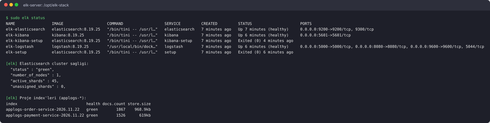
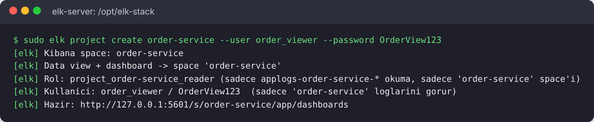
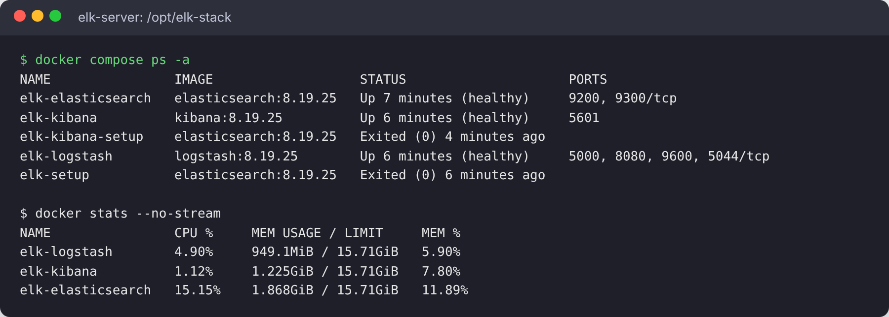
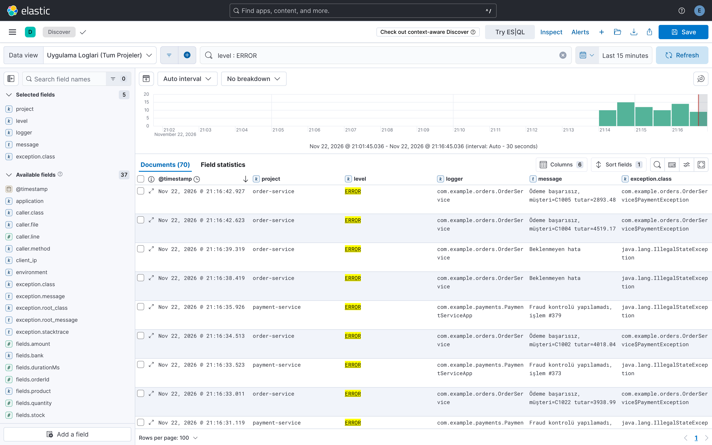
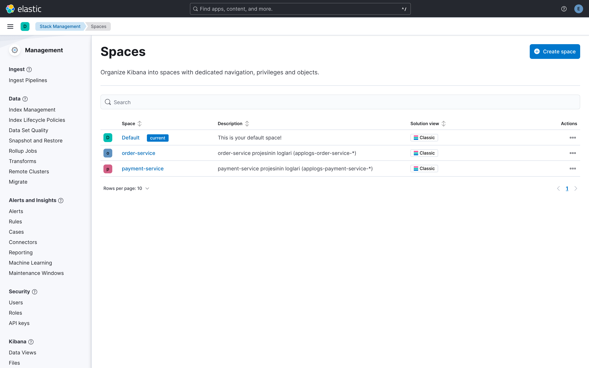
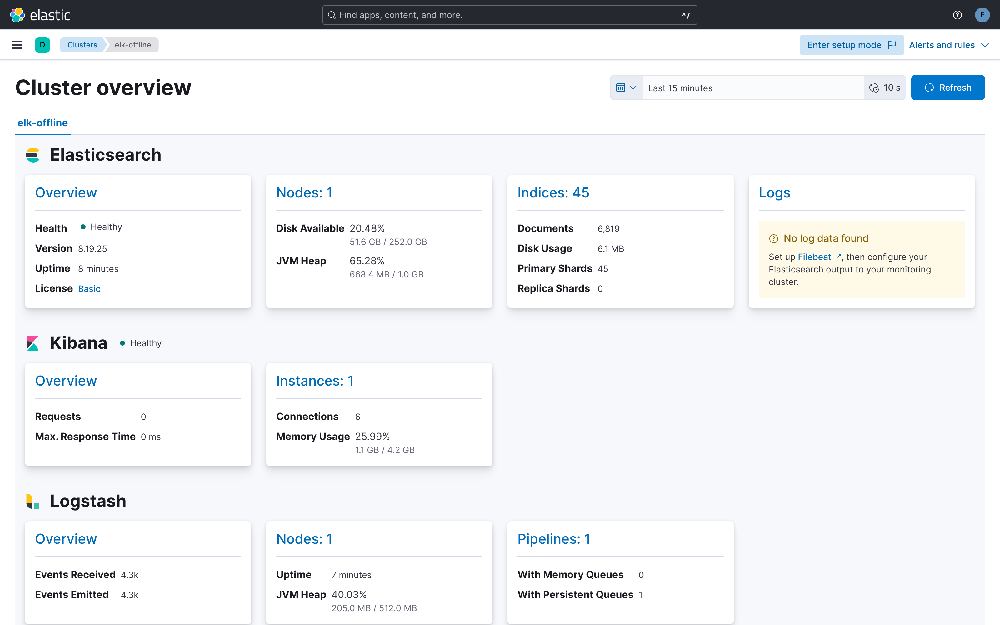
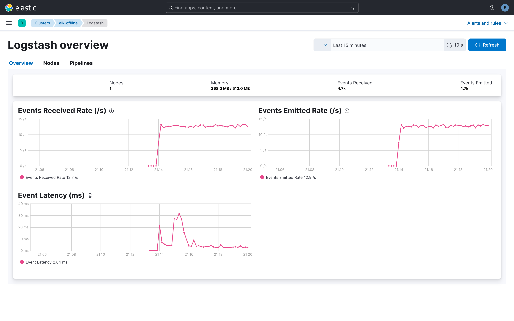
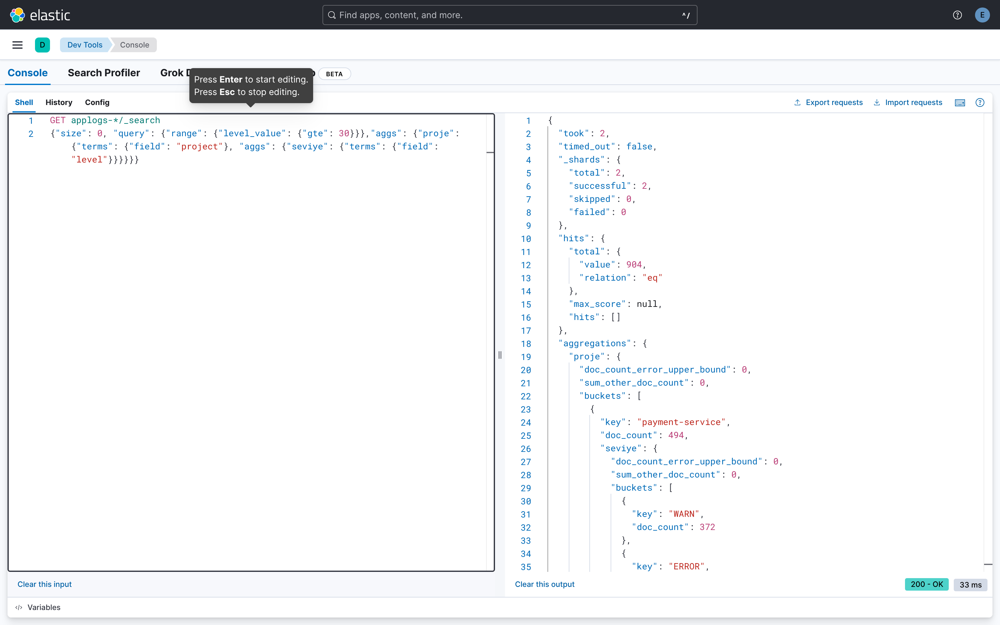
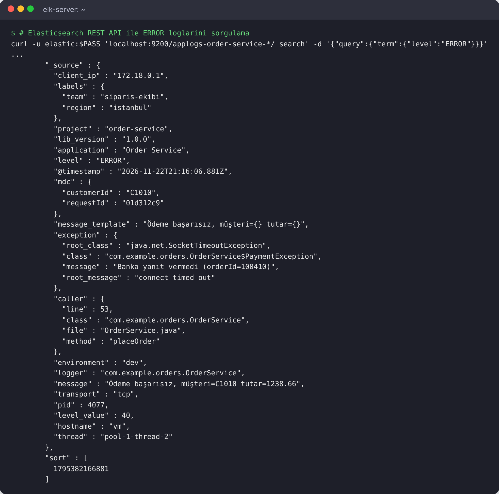

# ELK Dockerize + Java Logger Boilerplate (Offline / RHEL 8-9)

🇬🇧 English | [🇹🇷 Türkçe](README.md)

A ready-to-use boilerplate to bring up **Elasticsearch + Logstash + Kibana** on an **air-gapped** RHEL 8/9 server
(no internet, not even Docker installed) from **a single package**, and then ship logs from Java 11 applications to it
**just like using SLF4J** — without the applications knowing anything about the ELK environment.

```
 ┌──────────────── Java 11 applications (fully independent of each other) ────────────┐
 │  Project A (order-service)   Project B (payment-service)   Project C ...            │
 │  elk-logger.jar              elk-logger.jar (+ slf4j)                               │
 │  elk.project.name=A          elk.project.name=B                                     │
 └──────────┬───────────────────────────┬─────────────────────────────────────────────┘
            │ TCP 5000 (json_lines)      │ HTTP 8080 (JSON array)
            ▼                            ▼
 ┌─────────────────────── RHEL 8/9 server (Docker, offline) ──────────────────────────┐
 │  Logstash ──► Elasticsearch ──► Kibana (5601)                                       │
 │               applogs-a-2026.01.31   → Space "a" (sees only A)                      │
 │               applogs-b-2026.01.31   → Space "b" (sees only B)                      │
 └────────────────────────────────────────────────────────────────────────────────────┘
```


## Highlights

- **Fully offline install** on RHEL 8/9: static Docker binaries, `docker save`d images, SHA256-verified bundle, one `install.sh`.
- **Zero-dependency Java 11 library** (single jar): SLF4J-style API, `{}` placeholders, MDC, structured fields, async non-blocking delivery, retry + local fallback file, TLS.
- Works with **Maven, Gradle or plain Java** (no build tool, just the classpath) — plus an optional **SLF4J 2.x provider** so existing SLF4J code needs no changes.
- **One logging space per project**: separate daily indices `applogs-<project>-*`, a Kibana Space, a read-only role and (optionally) a user that sees only that project.
- Everything configurable from a properties file (connection, levels, queue, retry, TLS...), overridable with env vars / system properties.
- Ready-made Kibana dashboards, saved searches, ILM retention, Stack Monitoring, snapshot backups, `elk` management CLI.
- CI with unit tests and an end-to-end test against a real ELK stack; documentation for AI agents in [`docs/ai/`](docs/ai/README.md).

## Download the offline bundle

The single-file installation bundle (Docker + ELK images + library + docs) is published on
**[GitHub Releases](https://github.com/mr-ufukgurbuz/elk-dockerize-library-boilerplate/releases)**:

| File | Target server |
|---|---|
| `elk-offline-bundle-8.19.25-x86_64.tar.gz` + `.sha256` | Intel/AMD (x86_64) |
| `elk-offline-bundle-8.19.25-aarch64.tar.gz` + `.sha256` | ARM (aarch64) |

> At ~1.6 GB it is published as a Release asset instead of being committed to git.
> How it is built: [offline-bundle/README.en.md](offline-bundle/README.en.md).

## What are ELK and Docker?

| Component | What it does | Role in this project | Guide |
|---|---|---|---|
| **Elasticsearch** | Search engine that stores JSON documents and searches/filters them in milliseconds | Stores logs in per-project daily indices (`applogs-<project>-YYYY.MM.dd`) | [README](elk-stack/elasticsearch/README.en.md) |
| **Logstash** | Data pipeline: input → transform → output | Receives logs from apps on TCP 5000 / HTTP 8080, writes them to ES | [README](elk-stack/logstash/README.en.md) |
| **Kibana** | Web UI for Elasticsearch | Log search (KQL), dashboards, per-project Spaces, Stack Monitoring | [README](elk-stack/kibana/README.en.md) |
| **Docker** | Packages and runs applications as images/containers | Runs ELK from a single `docker-compose.yml`, portable without internet | [elk-stack](elk-stack/README.en.md) |
| **elk-logger** | This project's Java 11 library | Logs like SLF4J inside your app, ships to ELK | [README](libs/elk-logger/README.en.md) |

## Repository layout

| Directory | Contents |
|---|---|
| [`elk-stack/`](elk-stack/README.en.md) | `docker-compose.yml`, ES/Logstash/Kibana configuration, automatic setup (users/roles/ILM/template/dashboards), `bin/elk.sh` management tool |
| [`offline-bundle/`](offline-bundle/README.en.md) | `build-bundle.sh` (builds the bundle on an online machine), `install.sh` (installs Docker + ELK on offline RHEL), `uninstall.sh` |
| [`libs/elk-logger/`](libs/elk-logger/README.en.md) | **Zero-dependency** Java 11 logging library (single jar) |
| [`libs/elk-logger-slf4j/`](libs/elk-logger-slf4j) | Optional SLF4J 2.x provider: log to ELK without changing existing SLF4J code |
| [`examples/`](examples/README.en.md) | 4 samples: A (Maven, native API, TCP), B (Maven, SLF4J, HTTP), C (**Gradle**), D (**no build tool**, plain Java + classpath) |
| [`dist/`](dist) | Pre-built jars |
| [`docs/`](docs) | Detailed documentation (Turkish) |
| [`docs/ai/`](docs/ai/README.md) | Guide for AI coding agents refactoring this project (English) |
| [`docs/images/`](docs/images) | Screenshots (generated with [`tools/screenshots/`](tools/screenshots)) |

## Quick start (3 steps)

**1) Get the bundle:** download it from [Releases](https://github.com/mr-ufukgurbuz/elk-dockerize-library-boilerplate/releases)
**or** build it yourself on a machine with internet access (needs Docker or Podman + JDK 11 + Maven):

```bash
./offline-bundle/build-bundle.sh
```

→ `dist/elk-offline-bundle-8.19.25-x86_64.tar.gz` (~1.6 GB). Copy it to the offline server via USB/scp.

**2) Install and start on the offline RHEL server** (installs Docker if missing):

```bash
tar xzf elk-offline-bundle-8.19.25-x86_64.tar.gz
cd elk-offline-bundle-8.19.25-x86_64
sudo ./install.sh --open-firewall
```

At the end it prints the Kibana URL; the `elastic` user's password is in `/opt/elk-stack/.env`.

**3) Add the library to your Java project and log** — Maven, Gradle or plain Java with no build tool are all supported.
The library is a **single dependency-free jar**; it only needs to be on the classpath:

| Project type | Adding the jar | Where `elk-logger.properties` goes |
|---|---|---|
| **Maven** | `<dependency><groupId>io.github.elkboilerplate</groupId><artifactId>elk-logger</artifactId><version>1.0.0</version></dependency>` | `src/main/resources/` |
| **Gradle** | `implementation files('libs/elk-logger-1.0.0.jar')` | `src/main/resources/` |
| **Plain Java** | `java -cp "classes:lib/elk-logger-1.0.0.jar:config" com.acme.Main` — or `CLASSPATH`, `java @application.classpath`, MANIFEST `Class-Path`, IDE | `config/` on the classpath, the working directory, or `-Delk.config.file` |

Samples: [Maven](examples/order-service-sample), [Gradle](examples/gradle-sample/README.en.md), [plain Java](examples/plain-java-sample/README.en.md)

`elk-logger.properties`:

```properties
elk.project.name=order-service      # -> index: applogs-order-service-YYYY.MM.dd
elk.logstash.host=10.0.0.5          # ELK server
elk.logstash.tcp.port=5000
elk.level=INFO
```

```java
private static final ElkLogger log = ElkLoggerFactory.getLogger(OrderService.class);

log.info("Order created: {}", orderId);
log.error("Payment failed, order={}", orderId, exception);
log.atWarn().field("orderId", orderId).field("stock", 3).log("Low stock");
```

Kibana → **Dashboards → "Uygulama Loglari (Tum Projeler)"** (application logs, all projects).
Per-project space + user:

```bash
sudo elk project create order-service --user order_viewer
```

## Documentation

The detailed documentation set is in Turkish; code, commands and configuration keys are the same in any language.
The [AI agent guide](docs/ai/README.md) is in English and is a good technical overview.

| # | Document | Topic |
|---|---|---|
| 00 | [Overview & architecture](docs/00-GENEL-BAKIS.md) | Components, data flow, design decisions |
| 01 | [Building the offline bundle](docs/01-OFFLINE-PAKET-HAZIRLAMA.md) | Bundle build, releases, changing versions |
| 02 | [RHEL installation](docs/02-KURULUM-RHEL.md) | Offline Docker + ELK install, step by step, manual install |
| 03 | [Elasticsearch](docs/03-ELASTICSEARCH.md) | Index layout, mapping, query/filter examples, ILM |
| 04 | [Logstash](docs/04-LOGSTASH.md) | Pipeline, inputs, persistent queue, DLQ |
| 05 | [Kibana](docs/05-KIBANA.md) | Discover/KQL, dashboards, Spaces, Stack Monitoring, alerting |
| 06 | [Java library](docs/06-JAVA-KUTUPHANE.md) | Adding to Maven/Gradle/plain Java, API, MDC, structured fields, SLF4J bridge |
| 07 | [Configuration reference](docs/07-KONFIGURASYON-REFERANSI.md) | Every `elk.*` setting |
| 08 | [Sample projects](docs/08-ORNEK-PROJELER.md) | Running samples A/B (Maven), C (Gradle), D (plain Java) |
| 09 | [Operations & troubleshooting](docs/09-OPERASYON-VE-SORUN-GIDERME.md) | Backup, upgrades, disk, capacity, fixes |
| 10 | [Security](docs/10-GUVENLIK.md) | Users, roles, TLS, network |
| 11 | [Docker](docs/11-DOCKER.md) | Docker concepts, offline install, compose layout, commands |
| AI | [AI agent guide](docs/ai/README.md) (English) | Architecture map, contracts, recipes |

## Screenshots

| | |
|---|---|
| **After install** `elk summary`  | **Environment status** `elk status`  |
| **Creating a project space** `elk project create`  | **Docker containers**  |
| **Kibana Discover — KQL filter** (`level : ERROR`)  | **Document details — structured fields, MDC, exception**  |
| **Project user's dashboard** (own project only)  | **Kibana Spaces — one per project**  |
| **Stack Monitoring**  | **Logstash monitoring**  |
| **Elasticsearch — Dev Tools query**  | **Elasticsearch REST API**  |
| **Indices (one set per project)**  | **Java application console output**  |

> The Kibana objects and the sample log messages are in Turkish (e.g. *"Sipariş oluşturuldu"* = "Order created").

## Verified versions

| Component | Version |
|---|---|
| Elasticsearch / Logstash / Kibana | 8.19.25 |
| Docker (static binaries) | 29.10.0 |
| Docker Compose plugin | v5.7.1 |
| Java (library) | 11+ (no dependencies) |
| Gradle (sample C) | 8.14.3 (Gradle 9 requires JDK 17+) |
| SLF4J (optional) | 2.0.x |

## License

MIT — see [LICENSE](LICENSE).
