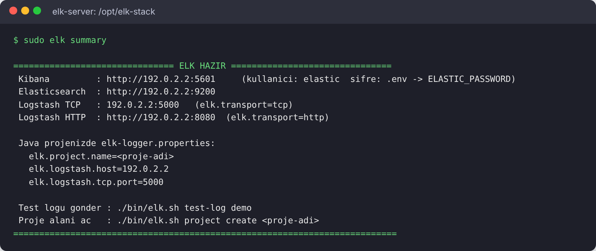
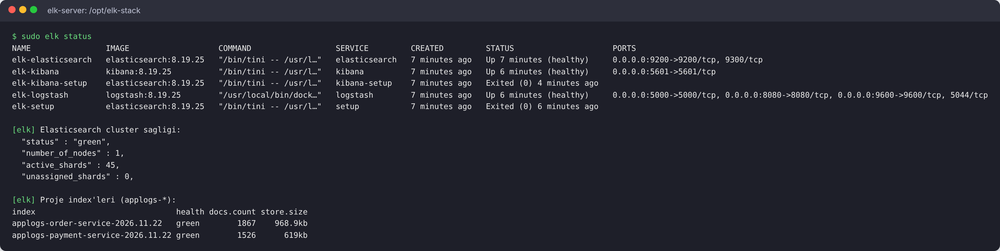
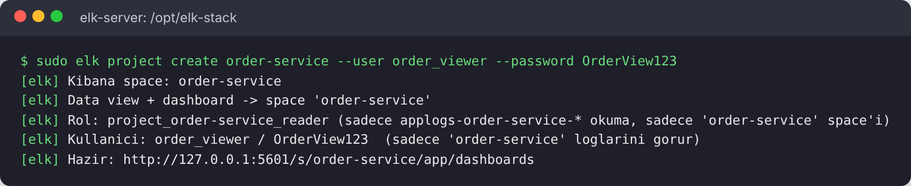
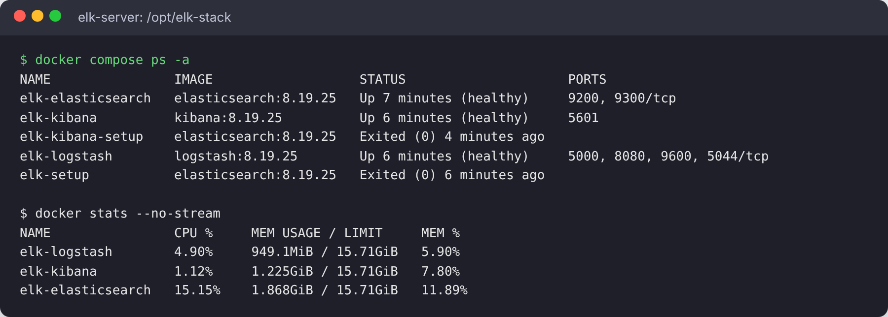
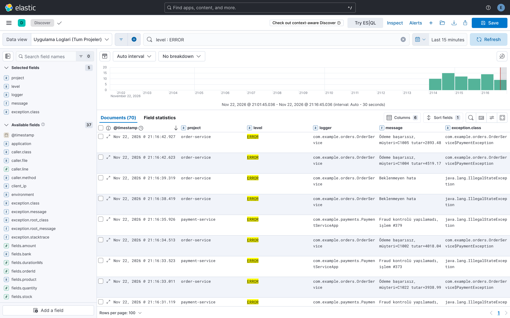
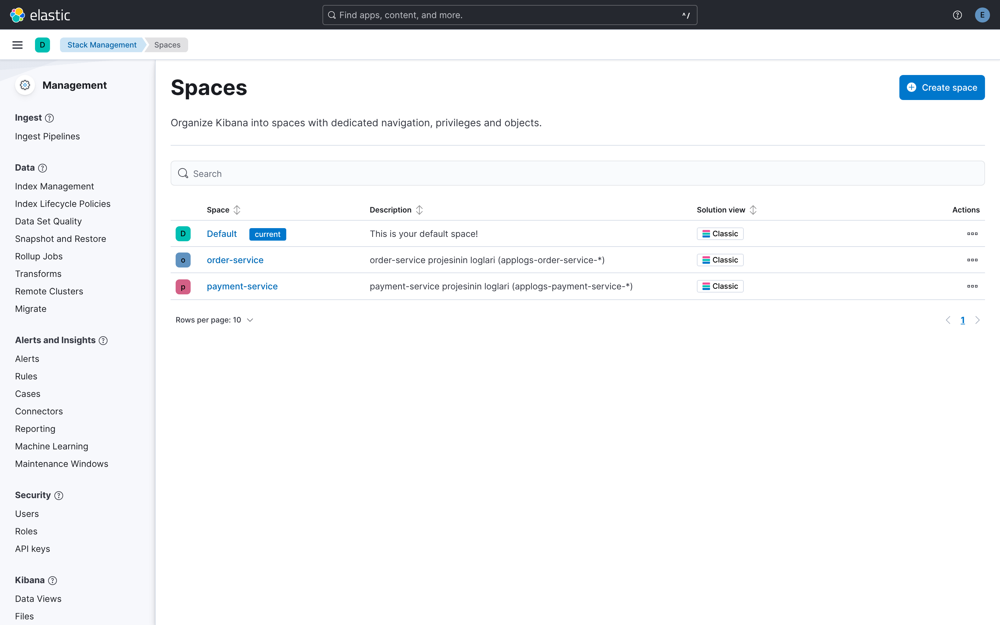
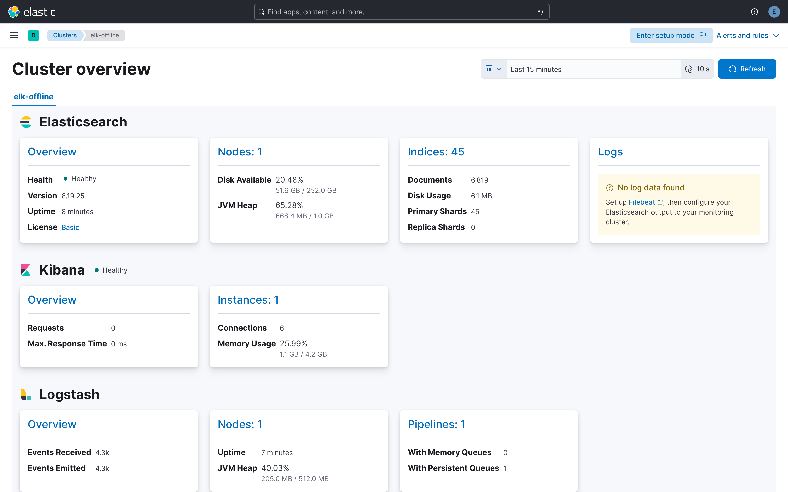
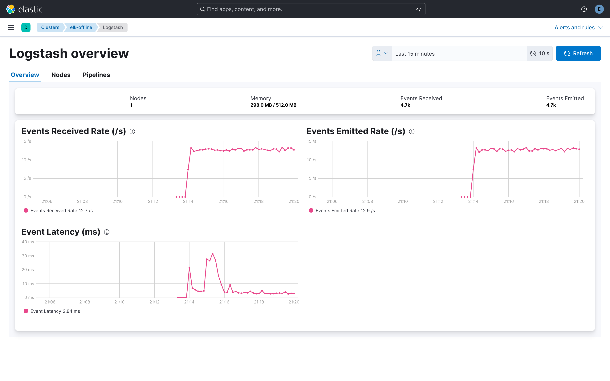
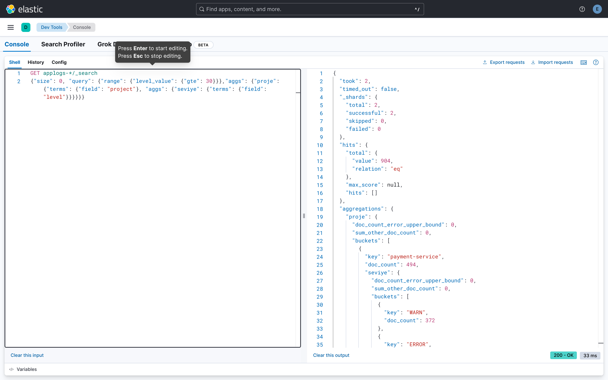
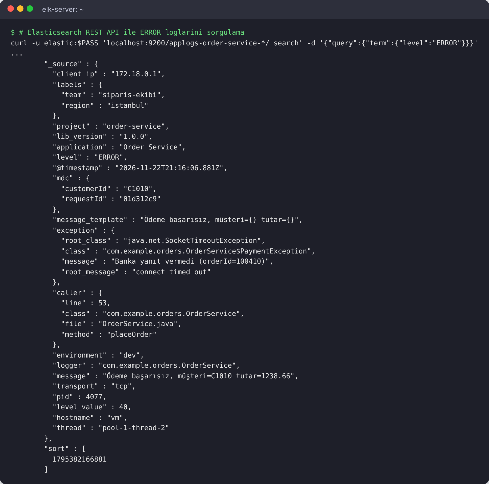

# ELK Dockerize + Java Logger Boilerplate (Offline / RHEL 8-9)

İnternet erişimi **olmayan** bir RHEL 8/9 sunucusunda, üzerinde Docker bile kurulu değilken,
**tek bir paketle** Elasticsearch + Logstash + Kibana ortamını ayağa kaldırmak; ardından Java 11
projelerinden **SLF4J kullanır gibi** bu ortama log göndermek için hazır boilerplate.

```
 ┌──────────── Java 11 uygulamaları (birbirinden tamamen bağımsız) ───────────┐
 │  Proje A (order-service)   Proje B (payment-service)   Proje C ...          │
 │  elk-logger.jar            elk-logger.jar (+ slf4j)                         │
 │  elk.project.name=A        elk.project.name=B                               │
 └──────────┬─────────────────────────┬───────────────────────────────────────┘
            │ TCP 5000 (json_lines)    │ HTTP 8080 (JSON dizi)
            ▼                          ▼
 ┌─────────────────────── RHEL 8/9 sunucu (Docker, offline) ──────────────────┐
 │  Logstash ──► Elasticsearch ──► Kibana (5601)                               │
 │               applogs-a-2026.01.31   → Space "a" (sadece A'yı görür)        │
 │               applogs-b-2026.01.31   → Space "b" (sadece B'yi görür)        │
 └────────────────────────────────────────────────────────────────────────────┘
```


## Hazır offline paketi indir

Tek dosyalık kurulum paketi (Docker + ELK imajları + kütüphane + dokümanlar) **[GitHub Releases](https://github.com/mr-ufukgurbuz/elk-dockerize-library-boilerplate/releases)** sayfasındadır:

| Dosya | Hedef sunucu |
|---|---|
| `elk-offline-bundle-8.19.25-x86_64.tar.gz` + `.sha256` | Intel/AMD (x86_64) |
| `elk-offline-bundle-8.19.25-aarch64.tar.gz` + `.sha256` | ARM (aarch64) |

> ~1.6 GB olduğu için git deposunun içinde değil, Release asset olarak yayınlanır. Nasıl üretildiği:
> [offline-bundle/README.md](offline-bundle/README.md).

## ELK ve Docker nedir?

| Bileşen | Ne işe yarar? | Bu projedeki rolü | Rehber |
|---|---|---|---|
| **Elasticsearch** | JSON dokümanları saklayan ve milisaniyede arayan/filtreleyen arama motoru | Logları proje bazlı günlük index'lerde (`applogs-<proje>-YYYY.MM.dd`) saklar | [README](elk-stack/elasticsearch/README.md) · [03](docs/03-ELASTICSEARCH.md) |
| **Logstash** | Veri alan → dönüştüren → hedefe yazan veri boru hattı | Uygulamalardan TCP 5000 / HTTP 8080 ile log alır, ES'ye yazar | [README](elk-stack/logstash/README.md) · [04](docs/04-LOGSTASH.md) |
| **Kibana** | Elasticsearch için web arayüzü | Log arama (KQL), dashboard, proje alanları (Space), Stack Monitoring | [README](elk-stack/kibana/README.md) · [05](docs/05-KIBANA.md) |
| **Docker** | Uygulamaları imaj/container olarak paketleyip çalıştırır | ELK'yı tek `docker-compose.yml` ile, internetsiz taşınabilir şekilde çalıştırır | [11](docs/11-DOCKER.md) · [elk-stack](elk-stack/README.md) |
| **elk-logger** | Bu projenin Java 11 kütüphanesi | Uygulama içinde SLF4J gibi loglar, ELK'ya gönderir | [README](libs/elk-logger/README.md) · [06](docs/06-JAVA-KUTUPHANE.md) |

## İçerik

| Dizin | Ne var? |
|---|---|
| [`elk-stack/`](elk-stack) | `docker-compose.yml`, ES/Logstash/Kibana konfigürasyonları, otomatik kurulum (kullanıcı/rol/ILM/template/dashboard), `bin/elk.sh` yönetim aracı |
| [`offline-bundle/`](offline-bundle) | `build-bundle.sh` (internetli makinede paket üretir), `install.sh` (offline RHEL'e Docker + ELK kurar), `uninstall.sh` |
| [`libs/elk-logger/`](libs/elk-logger) | **Bağımlılıksız** Java 11 loglama kütüphanesi (tek jar) |
| [`libs/elk-logger-slf4j/`](libs/elk-logger-slf4j) | Opsiyonel SLF4J 2.x provider: mevcut SLF4J kodunu değiştirmeden ELK'ya loglama |
| [`examples/`](examples) | Örnek Proje A (native API, TCP) ve Örnek Proje B (SLF4J, HTTP) |
| [`dist/`](dist) | Hazır derlenmiş jar'lar |
| [`docs/`](docs) | Türkçe kapsamlı doküman seti |
| [`docs/ai/`](docs/ai) | Bu projeyi refactor edecek yapay zeka ajanları için rehber (İngilizce) |
| [`docs/images/`](docs/images) | Dokümanlardaki ekran görüntüleri ([`tools/screenshots/`](tools/screenshots) ile üretilir) |

## Hızlı Başlangıç (3 adım)

**1) Paketi edin:** [Releases](https://github.com/mr-ufukgurbuz/elk-dockerize-library-boilerplate/releases) sayfasından indirin **veya** internetli bir makinede kendiniz üretin (Docker veya Podman + JDK 11 + Maven gerekir):

```bash
./offline-bundle/build-bundle.sh
```

→ `dist/elk-offline-bundle-8.19.25-x86_64.tar.gz` (~1.6 GB). Bu dosyayı USB/scp ile offline sunucuya taşıyın.
(GitHub Actions'taki **"Offline Bundle"** workflow'u da aynı paketi artifact olarak üretir.)

**2) Offline RHEL sunucusunda kur ve başlat** (Docker yoksa kendisi kurar):

```bash
tar xzf elk-offline-bundle-8.19.25-x86_64.tar.gz
cd elk-offline-bundle-8.19.25-x86_64
sudo ./install.sh --open-firewall
```

Kurulum sonunda Kibana adresi ve `elastic` kullanıcısının şifresi (`/opt/elk-stack/.env`) gösterilir.

**3) Java projene ekle ve logla:**

```xml
<dependency>
  <groupId>io.github.elkboilerplate</groupId>
  <artifactId>elk-logger</artifactId>
  <version>1.0.0</version>
</dependency>
```

`src/main/resources/elk-logger.properties`:

```properties
elk.project.name=order-service      # -> index: applogs-order-service-YYYY.MM.dd
elk.logstash.host=10.0.0.5          # ELK sunucusu
elk.logstash.tcp.port=5000
elk.level=INFO
```

```java
private static final ElkLogger log = ElkLoggerFactory.getLogger(OrderService.class);

log.info("Sipariş oluşturuldu: {}", orderId);
log.error("Ödeme alınamadı, sipariş={}", orderId, exception);
log.atWarn().field("orderId", orderId).field("stock", 3).log("Stok azaldı");
```

Kibana → **Dashboards → "Uygulama Logları"**. Projeye özel alan + kullanıcı için:

```bash
sudo elk project create order-service --user order_viewer
```

## Dokümanlar

| # | Doküman | Konu |
|---|---|---|
| 00 | [Genel Bakış ve Mimari](docs/00-GENEL-BAKIS.md) | Bileşenler, veri akışı, tasarım kararları |
| 01 | [Offline Paket Hazırlama](docs/01-OFFLINE-PAKET-HAZIRLAMA.md) | İnternetli makinede paket üretimi, sürüm değiştirme |
| 02 | [RHEL Kurulum](docs/02-KURULUM-RHEL.md) | Offline Docker + ELK kurulumu, adım adım, elle kurulum |
| 03 | [Elasticsearch](docs/03-ELASTICSEARCH.md) | Index yapısı, mapping, sorgu/filtreleme örnekleri, ILM |
| 04 | [Logstash](docs/04-LOGSTASH.md) | Pipeline, input'lar, kalıcı kuyruk, DLQ |
| 05 | [Kibana](docs/05-KIBANA.md) | Discover/KQL filtreleme, dashboard, Space'ler, Stack Monitoring, alarmlar |
| 06 | [Java Kütüphanesi](docs/06-JAVA-KUTUPHANE.md) | API, MDC, yapısal alanlar, SLF4J köprüsü, projeye ekleme |
| 07 | [Konfigürasyon Referansı](docs/07-KONFIGURASYON-REFERANSI.md) | Tüm `elk.*` ayarları |
| 08 | [Örnek Projeler](docs/08-ORNEK-PROJELER.md) | Proje A / Proje B çalıştırma |
| 09 | [Operasyon ve Sorun Giderme](docs/09-OPERASYON-VE-SORUN-GIDERME.md) | Yedekleme, güncelleme, disk, kapasite, hata çözümleri |
| 10 | [Güvenlik](docs/10-GUVENLIK.md) | Kullanıcılar, roller, TLS, ağ |
| 11 | [Docker](docs/11-DOCKER.md) | Docker kavramları, offline kurulum, compose yapısı, komutlar |
| AI | [AI Refactor Rehberi](docs/ai/README.md) | Ajanlar için mimari harita, sözleşmeler, tarifler |

## Ekran Görüntüleri

| | |
|---|---|
| **Kurulum sonrası** `elk summary`  | **Ortam durumu** `elk status`  |
| **Proje alanı açma** `elk project create`  | **Docker container'ları**  |
| **Kibana Discover — KQL filtre** (`level : ERROR`)  | **Doküman detayı — yapısal alanlar, MDC, exception**  |
| **Proje kullanıcısının dashboard'u** (sadece kendi projesi)  | **Kibana Spaces — proje başına alan**  |
| **Stack Monitoring**  | **Logstash izleme**  |
| **Elasticsearch — Dev Tools sorgusu**  | **Elasticsearch REST API**  |
| **Index'ler (proje başına)**  | **Java uygulaması konsol çıktısı**  |

## Doğrulanmış Sürümler

| Bileşen | Sürüm |
|---|---|
| Elasticsearch / Logstash / Kibana | 8.19.25 |
| Docker (statik binary) | 29.10.0 |
| Docker Compose plugin | v5.7.1 |
| Java (kütüphane) | 11+ (bağımlılık yok) |
| SLF4J (opsiyonel) | 2.0.x |

## Lisans

MIT — bkz. [LICENSE](LICENSE).
