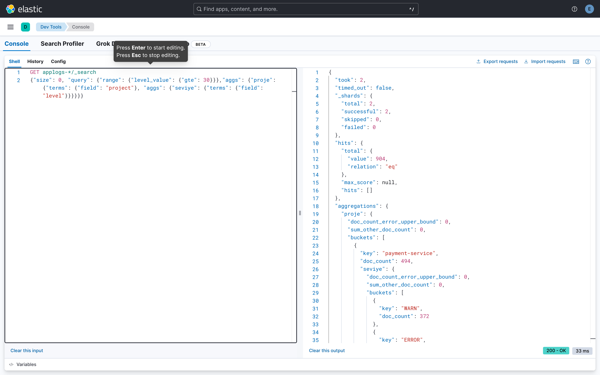
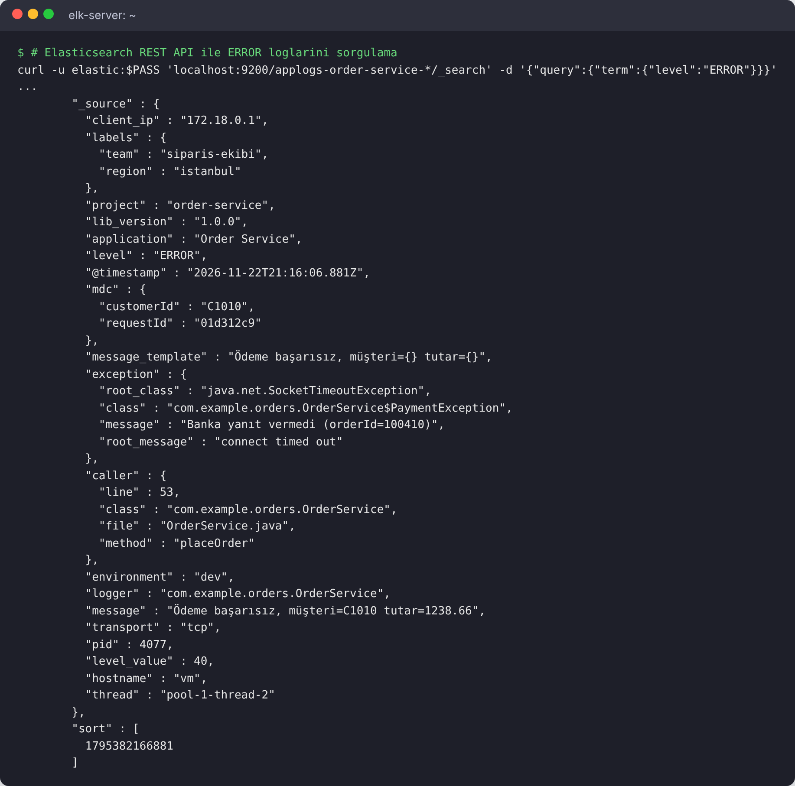
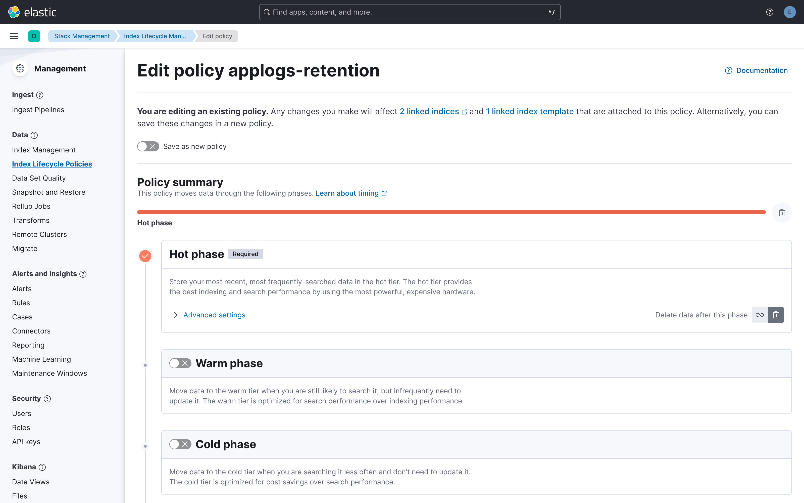

# 03 — Elasticsearch

> **Elasticsearch nedir?** JSON dokümanları saklayan, her alanı indeksleyen ve büyük veri üzerinde milisaniyeler içinde
> arama/filtreleme/istatistik yapan bir arama motorudur. Bu projede logların saklandığı ve sorgulandığı yerdir.
> Kavramlar (index, mapping, keyword/text, shard, ILM): [elk-stack/elasticsearch/README.md](../elk-stack/elasticsearch/README.md).

## 1. Rolü ve konfigürasyonu

Tek node (`discovery.type: single-node`), güvenlik açık (kullanıcı/şifre), HTTP TLS kapalı.
Dosya: [`elk-stack/elasticsearch/elasticsearch.yml`](../elk-stack/elasticsearch/elasticsearch.yml).
Heap: `.env` → `ES_HEAP` (RAM'in en fazla yarısı, ≤31g).

| Ayar | Değer | Neden |
|---|---|---|
| `xpack.security.enabled` | `true` | Proje bazlı rol/kullanıcı izolasyonu için şart |
| `xpack.monitoring.collection.enabled` | `true` | Kibana Stack Monitoring ekranı |
| `ingest.geoip.downloader.enabled` | `false` | Offline: internete çıkmaya çalışmasın |
| `path.repo` | `/usr/share/elasticsearch/snapshots` | Snapshot (yedek) dizini |
| `action.destructive_requires_name` | `true` | `DELETE /*` gibi kazaları engeller |
| disk watermark | 85/90/95% | Disk dolarken index'ler salt-okunur olur (bkz. 09) |

## 2. Index yapısı

| Kavram | Değer |
|---|---|
| Index adı | `applogs-<project>-YYYY.MM.dd` (UTC günü) — örn. `applogs-order-service-2026.01.31` |
| Index template | `applogs` (pattern `applogs-*`, priority 500) — [`index-template.json`](../elk-stack/setup/es/index-template.json) |
| Shard / replica | 1 / 0 (tek node) |
| Saklama | ILM politikası `applogs-retention`: `LOG_RETENTION_DAYS` gün sonra index silinir |
| Refresh | 5 sn (log yazıldıktan ~5 sn sonra aranabilir) |
| Sıkıştırma | `best_compression` |

### Alanlar (mapping)

| Alan | Tip | Örnek | Not |
|---|---|---|---|
| `@timestamp` | date | `2026-01-31T10:15:30.123Z` | Olayın uygulamada oluştuğu an (UTC) |
| `project` | keyword | `order-service` | Loglama alanı |
| `application` | keyword | `Order Service` | |
| `environment` | keyword | `prod` | |
| `hostname` | keyword | `app-server-01` | Uygulamanın çalıştığı makine |
| `client_ip` | keyword | `10.0.0.21` | Logstash'in gördüğü gönderen IP |
| `transport` | keyword | `tcp` / `http` | |
| `pid` | long | `12345` | |
| `level` | keyword | `ERROR` | TRACE/DEBUG/INFO/WARN/ERROR |
| `level_value` | integer | `40` | TRACE=0, DEBUG=10, INFO=20, WARN=30, ERROR=40 → aralık sorgusu |
| `logger` | keyword | `com.acme.OrderService` | |
| `thread` | keyword | `http-nio-8080-exec-3` | |
| `message` | text (+`message.keyword`) | `Sipariş oluşturuldu: 42` | Tam metin aranabilir |
| `message_template` | keyword | `Sipariş oluşturuldu: {}` | Aynı tip mesajları gruplamak için çok faydalı |
| `exception.class` | keyword | `java.net.SocketTimeoutException` | |
| `exception.message` | text | | |
| `exception.root_class` / `root_message` | keyword / text | | En içteki cause |
| `exception.stacktrace` | text | | Tam metin aranabilir |
| `mdc.*` | keyword | `mdc.requestId` | MDC değerleri |
| `fields.*` | dinamik | `fields.orderId` (long), `fields.product` (keyword + `.text`) | Yapısal alanlar |
| `labels.*` | keyword | `labels.team` | Konfigürasyondaki sabit etiketler |
| `tags` | keyword | `["checkout","AUDIT"]` | |
| `caller.class/method/file/line` | keyword/integer | | `elk.include.caller=true` ise |
| `lib_version` | keyword | `1.0.0` | |

> `fields.*` dinamik eşlenir: ilk gelen değerin tipi o günün index'inde sabitlenir. Aynı alana bir
> projede bazen sayı bazen metin yazmayın. `index.mapping.ignore_malformed: true` olduğu için uyumsuz
> değer **olayı düşürmez**, sadece o alan indekslenmez.

## 3. Sorgu ve filtreleme örnekleri

Aşağıdaki örnekler Kibana → **Dev Tools** konsoluna yapıştırılabilir. Komut satırından:
`curl -u elastic:$ELASTIC_PASSWORD -H 'Content-Type: application/json' http://localhost:9200/...`





### 3.1 Bir projenin son 15 dakikadaki ERROR logları
```json
GET applogs-order-service-*/_search
{
  "size": 50,
  "sort": [{ "@timestamp": "desc" }],
  "query": { "bool": { "filter": [
    { "term":  { "level": "ERROR" } },
    { "range": { "@timestamp": { "gte": "now-15m" } } }
  ]}}
}
```

### 3.2 WARN ve üstü (seviye aralığı)
```json
GET applogs-*/_search
{ "query": { "range": { "level_value": { "gte": 30 } } } }
```

### 3.3 Log metninde arama
```json
GET applogs-payment-service-*/_search
{ "query": { "match": { "message": "ödeme başarısız" } } }

GET applogs-*/_search
{ "query": { "match_phrase": { "message": "connection refused" } } }

GET applogs-*/_search
{ "query": { "wildcard": { "message.keyword": { "value": "*timeout*", "case_insensitive": true } } } }
```

### 3.4 Exception tipine / stack trace'e göre
```json
GET applogs-*/_search
{ "query": { "term": { "exception.class": "java.net.SocketTimeoutException" } } }

GET applogs-*/_search
{ "query": { "match_phrase": { "exception.stacktrace": "OrderRepository.save" } } }
```

### 3.5 MDC / yapısal alan / etiket
```json
GET applogs-order-service-*/_search
{ "query": { "term": { "mdc.requestId": "a1b2c3d4" } } }

GET applogs-order-service-*/_search
{ "query": { "bool": { "filter": [
  { "term":  { "fields.product": "laptop" } },
  { "range": { "fields.amount": { "gte": 1000 } } }
]}}}

GET applogs-*/_search
{ "query": { "term": { "tags": "AUDIT" } } }
```

### 3.6 İstatistikler (aggregation)
```json
// Proje ve seviyeye göre sayılar (son 24 saat)
GET applogs-*/_search
{
  "size": 0,
  "query": { "range": { "@timestamp": { "gte": "now-24h" } } },
  "aggs": { "proje": { "terms": { "field": "project" },
            "aggs": { "seviye": { "terms": { "field": "level" } } } } }
}

// En sık hata mesajı kalıpları
GET applogs-*/_search
{
  "size": 0,
  "query": { "term": { "level": "ERROR" } },
  "aggs": { "kalip": { "terms": { "field": "message_template", "size": 20 } } }
}
```

### 3.7 ES|QL (Kibana Discover'da da kullanılabilir)
```
FROM applogs-*
| WHERE level_value >= 30 AND @timestamp > NOW() - 1 hour
| STATS adet = COUNT(*) BY project, level
| SORT adet DESC
```
```
FROM applogs-order-service-*
| WHERE exception.class IS NOT NULL
| STATS adet = COUNT(*) BY exception.class, logger
| SORT adet DESC | LIMIT 10
```

## 4. ILM (saklama süresi)

```json
GET _ilm/policy/applogs-retention
GET applogs-*/_ilm/explain
```

Süreyi değiştirmek: `.env` → `LOG_RETENTION_DAYS=60` ve `sudo elk up` (setup servisi politikayı günceller;
mevcut index'lere de uygulanır). Proje bazlı farklı süre gerekiyorsa: yeni bir politika oluşturup
`PUT applogs-<proje>-*/_settings {"index.lifecycle.name": "<politika>"}` ve kalıcılık için
`applogs-<proje>-*` pattern'li, daha yüksek priority'li ek bir index template ekleyin.




## 5. Faydalı yönetim komutları

```bash
curl -u elastic:$P localhost:9200/_cluster/health?pretty
curl -u elastic:$P 'localhost:9200/_cat/indices/applogs-*?v&s=index'
curl -u elastic:$P 'localhost:9200/_cat/allocation?v'               # disk kullanımı
curl -u elastic:$P -X DELETE 'localhost:9200/applogs-demo-*'        # bir projenin loglarını sil
curl -u elastic:$P 'localhost:9200/_index_template/applogs?pretty'
```

## 6. Kullanıcılar ve roller (setup'ın oluşturdukları)

| Ad | Tip | Yetki |
|---|---|---|
| `elastic` | built-in kullanıcı | Süper kullanıcı (yönetim, Kibana girişi) |
| `kibana_system` | built-in | Kibana → ES bağlantısı |
| `logstash_system` | built-in | Logstash monitoring verisi |
| `logstash_writer` | kullanıcı | `applogs_writer` rolü: sadece `applogs-*`'a yazma |
| `applogs_reader_all` | rol | Tüm projeleri okuma (kullanıcılara atanabilir) |
| `project_<p>_reader` | rol (`elk project create`) | Sadece `applogs-<p>-*` okuma + `<p>` Kibana Space'i |

Detay: [10-GUVENLIK](10-GUVENLIK.md).
