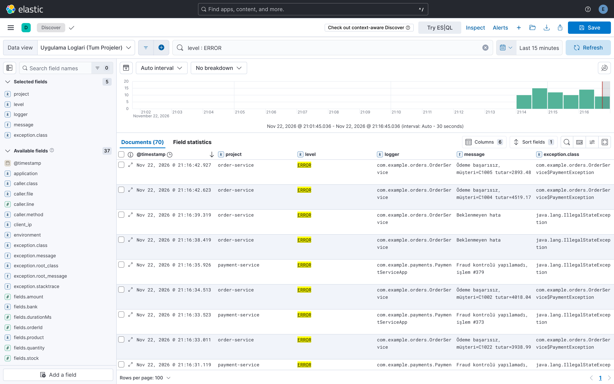
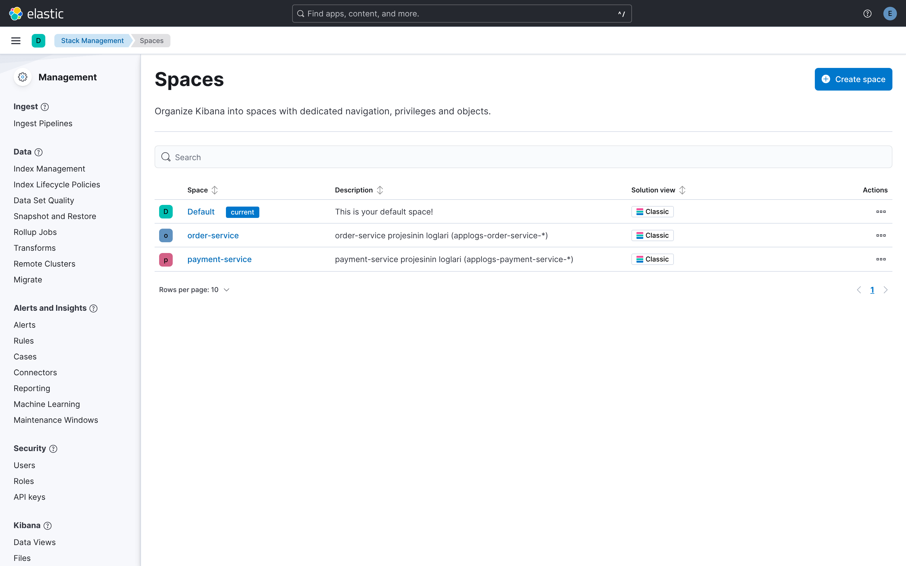
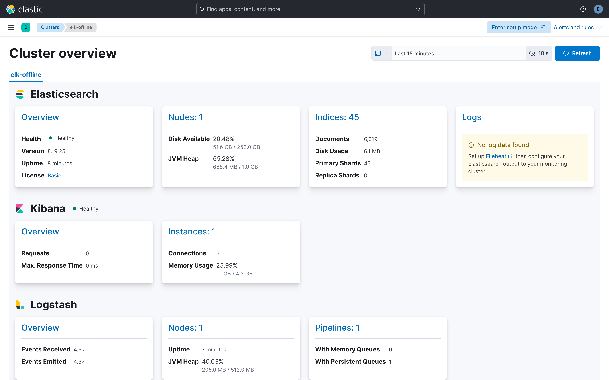
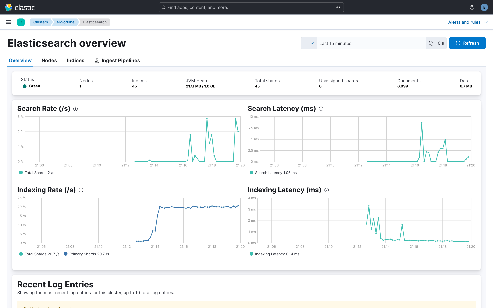

# 05 — Kibana: Arama, Dashboard, Proje Alanları ve İzleme

> **Kibana nedir?** Elasticsearch'teki veriyi tarayıcıdan aramak, görselleştirmek ve izlemek için web arayüzüdür.
> Kavramlar (data view, KQL, Space, Lens): [elk-stack/kibana/README.md](../elk-stack/kibana/README.md).

Adres: `http://<sunucu>:5601` — Kullanıcı `elastic`, şifre `/opt/elk-stack/.env` → `ELASTIC_PASSWORD`.
Kibana offline çalışacak şekilde yapılandırılmıştır (telemetri, haber akışı, harita servisi kapalı).

## 1. Kurulumla gelen hazır nesneler

`kibana-setup` servisi ilk açılışta **Default** space'e şunları kurar:

| Nesne | Ad |
|---|---|
| Data view | **Uygulama Logları (Tüm Projeler)** — `applogs-*` (varsayılan data view) |
| Kayıtlı arama | Tüm Loglar (Tüm Projeler) |
| Kayıtlı arama | Hata ve Uyarılar (Tüm Projeler) — `level:(ERROR or WARN)` |
| Dashboard | **Uygulama Logları (Tüm Projeler)** — toplam/ERROR/WARN sayıları, zamana göre seviye dağılımı, projelere/sunuculara göre dağılım, zamana göre hatalar, en çok hata üreten sınıflar, son hata/uyarı listesi. 30 sn'de bir yenilenir. |

Nesneler [`setup/kibana/generate-saved-objects.py`](../elk-stack/setup/kibana/generate-saved-objects.py)
ile üretilir; değiştirip `python3 generate-saved-objects.py > applogs-saved-objects.ndjson` ve `sudo elk up`.


## 2. Discover ile log arama ve filtreleme

Menü → **Discover** → sol üstten data view seçin → sağ üstten zaman aralığı.



### KQL örnekleri (arama çubuğu)

| Amaç | KQL |
|---|---|
| Sadece ERROR | `level : ERROR` |
| WARN ve üstü | `level_value >= 30` |
| Bir proje | `project : "order-service"` |
| Metin arama | `message : "ödeme başarısız"` |
| Kelime geçen | `message : *timeout*` |
| Bir sınıf ve alt paketleri | `logger : com.acme.orders*` |
| Exception tipi | `exception.class : "java.net.SocketTimeoutException"` |
| Stack trace içinde | `exception.stacktrace : "OrderRepository"` |
| Bir isteğin tüm logları | `mdc.requestId : "a1b2c3d4"` |
| Yapısal alan | `fields.product : "laptop" and fields.amount > 1000` |
| Etiket | `tags : "AUDIT"` |
| Prod'daki hatalar, belirli sunucu hariç | `environment : prod and level : ERROR and not hostname : "test-01"` |
| Exception'ı olan her şey | `exception.class : *` |

İpuçları:
- Soldaki alan listesinden bir alana tıklayıp **+ / −** ile filtre ekleyin; **"Add"** ile tabloya sütun yapın.
- Bir logu açıp (⤢) **"View surrounding documents"** ile öncesi/sonrasını görün.
- Aramayı **Save** ile kaydedip dashboard'a ekleyin.
- **ES|QL** moduna geçip SQL benzeri sorgu yazabilirsiniz (örnekler: [03](03-ELASTICSEARCH.md#37-esql-kibana-discoverda-da-kullanılabilir)).

Bir dokümanı açınca tüm alanlar (MDC, fields, exception, caller) görünür:


## 3. Proje bazlı alanlar (Spaces)

```bash
sudo elk project create order-service                                   # space + data view + dashboard + rol
sudo elk project create order-service --user siparis_ekibi --password 'S1fre!'   # + sadece bu projeyi gören kullanıcı
sudo elk project create order-service --user siparis_lead --editor      # kendi space'inde dashboard düzenleyebilir
sudo elk project list
```

Sonuç:
- Kibana'da sol üstteki space seçicide **order-service** space'i,
- İçinde **Uygulama Logları (order-service)** dashboard'u ve `applogs-order-service-*` data view'ı,
- `siparis_ekibi` kullanıcısı giriş yaptığında **sadece** bu space'i ve **sadece** order-service loglarını görür
  (ES seviyesinde de engellenir: `applogs-*` sorgusu bile yalnızca kendi index'lerini döndürür).

Var olan bir kullanıcıya proje yetkisi vermek: **Stack Management → Users →** kullanıcı → rol olarak
`project_<proje>_reader` ekleyin. Tüm projeleri okuyabilen rol: `applogs_reader_all` (+ space yetkisi).



`order_viewer` kullanıcısının gördüğü:


## 4. Kendi görselleştirmenizi yapmak

1. **Dashboards → Create dashboard → Create visualization** (Lens).
2. Data view seçin; alanı sürükleyip bırakın. Örnekler:
   - *Yatay çubuk:* `message_template` Top 10, filtre `level : ERROR` → en sık hata kalıpları
   - *Çizgi:* `@timestamp` × Count, Break down by `application`
   - *Metric:* Unique count of `mdc.customerId`
   - *Tablo:* `fields.product` × Average `fields.amount`
3. Kaydedip dashboard'a ekleyin.

## 5. Stack Monitoring (ELK'nın kendisini izleme)

Menü → **Stack Monitoring** (ilk açılışta "Or, set up with self monitoring" çıkarsa onaylayın).

| Ekran | Gösterir |
|---|---|
| Elasticsearch | Cluster sağlığı, node CPU/JVM heap/disk, index boyutları, arama/indeksleme hızı |
| Kibana | Yanıt süreleri, istek sayısı, bellek |
| Logstash | Olay alım/gönderim hızı, pipeline gecikmesi, JVM, kalıcı kuyruk |

Veri `.monitoring-*` index'lerinde tutulur (internal collection; 8.x'te desteklenir, 9.x'te kaldırıldı).
Ayrıca **Stack Management → Index Management** üzerinden `applogs-*` index'lerinin boyut ve doküman sayısı,
**Index Lifecycle Policies → applogs-retention** üzerinden saklama politikası görülebilir.





## 6. Alarmlar (Alerting)

Basic lisansta **Stack Management → Rules** ile kural oluşturulabilir; offline ortamda e-posta/Slack
connector'ları dış ağa çıkamayabilir, ancak **Index** ve **Server log** connector'ları çalışır.

Örnek: "Son 5 dakikada bir projede 10'dan fazla ERROR":
1. Rules → Create rule → **Elasticsearch query** (veya *Log threshold*)
2. Data view `applogs-*`, KQL `level : ERROR`, *Group by* `project`, *IS ABOVE 10*, *FOR THE LAST 5 minutes*
3. Action: **Server log** (Kibana loguna yazar) veya **Index** (ör. `alerts-applogs` index'ine kayıt).
   Kurum içi SMTP sunucunuz varsa **Email** connector'ı kullanılabilir.

## 7. Saved object yedekleme / taşıma

**Stack Management → Saved objects → Export** (ndjson) ve başka bir ortama **Import**.
Komut satırı:
```bash
curl -u elastic:$P -X POST localhost:5601/api/saved_objects/_export -H 'kbn-xsrf: true' \
  -H 'Content-Type: application/json' -d '{"type":["dashboard","index-pattern","search","visualization","lens"]}' > kibana-objects.ndjson
```
