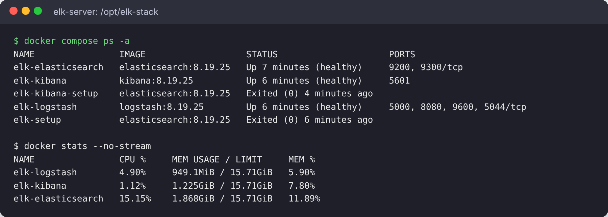

# 11 — Docker: Kavramlar ve Bu Projedeki Kullanımı

## 1. Docker nedir, neden kullanıyoruz?

**Docker**, bir uygulamayı ve çalışması için gereken her şeyi (işletim sistemi kütüphaneleri, Java, konfigürasyon)
**imaj** adı verilen tek bir paket hâlinde taşıyıp, sunucuda **container** (izole süreç) olarak çalıştırmayı sağlar.

Bu projede Docker'ın sağladıkları:

| İhtiyaç | Docker'sız | Docker ile |
|---|---|---|
| ES/Logstash/Kibana kurulumu | 3 ayrı RPM, Java sürümü, kullanıcı, servis dosyası, RHEL 8/9 farkları | 3 imaj, tek `docker-compose.yml` |
| Offline taşıma | Her bağımlılığı tek tek indirmek | `docker save` → tek `.tar`, sunucuda `docker load` |
| Sürüm yükseltme / geri alma | Paket yönetimi, konfig çakışmaları | `.env`'de `ELK_VERSION` değiştir, `elk up` |
| Temizlik | Dağınık dosyalar | `docker compose down -v` |

## 2. Temel kavramlar

| Kavram | Açıklama | Bu projede |
|---|---|---|
| **İmaj (image)** | Salt-okunur uygulama şablonu | `elasticsearch:8.19.25`, `logstash:8.19.25`, `kibana:8.19.25` |
| **Container** | İmajdan çalışan örnek | `elk-elasticsearch`, `elk-logstash`, `elk-kibana`, `elk-setup`, `elk-kibana-setup` |
| **Volume** | Container silinse de kalan veri alanı | `elk_es-data`, `elk_es-snapshots`, `elk_ls-data`, `elk_kibana-data` |
| **Bind mount** | Sunucudaki bir dosyayı container'a bağlama | `elasticsearch.yml`, `logstash.yml`, `applogs.conf`, `kibana.yml`, `setup/` |
| **Network** | Container'ların birbirini isimle bulduğu sanal ağ | `elk` (ör. Logstash → `http://elasticsearch:9200`) |
| **Port yayınlama** | Sunucu portunu container portuna yönlendirme | 5601, 9200, 5000, 8080, 9600 |
| **Healthcheck** | Container'ın "hazır" olup olmadığını test eden komut | Her serviste tanımlı; `elk up` bunu bekler |
| **Docker Compose** | Birden fazla container'ı tek YAML ile tanımlama/yönetme | `elk-stack/docker-compose.yml` |
| **Registry** | İmajların indirildiği sunucu (Docker Hub) | Offline sunucuda **kullanılmaz** (`pull_policy: never`) |

## 3. Offline sunucuya Docker nasıl kuruluyor?

RHEL 8/9'da Docker'ın RPM kurulumu internetteki depolara ve `container-selinux` gibi bağımlılıklara ihtiyaç duyar.
Bunun yerine Docker'ın resmi **statik binary** dağıtımı kullanılır — RHEL 8 ve 9'da aynı dosyalar çalışır:

```
docker-29.10.0.tgz            → /usr/local/bin/{docker,dockerd,containerd,containerd-shim-runc-v2,ctr,runc,docker-init,docker-proxy}
docker-compose (plugin)       → /usr/local/lib/docker/cli-plugins/docker-compose
docker.service (systemd)      → /etc/systemd/system/docker.service
daemon.json                   → /etc/docker/daemon.json   (log rotasyonu, nofile limiti, live-restore, [data-root])
```
Detaylı adımlar: [02-KURULUM-RHEL §4](02-KURULUM-RHEL.md#4-elle-kurulum-script-kullanmadan).

`daemon.json` içeriği ve anlamı:

```jsonc
{
  "log-driver": "json-file",
  "log-opts": { "max-size": "50m", "max-file": "3" },          // container stdout logları disk doldurmasın
  "default-ulimits": { "nofile": { "Name": "nofile", "Soft": 65535, "Hard": 65535 } },  // Elasticsearch gereksinimi
  "live-restore": true,                                          // dockerd yeniden başlasa da container'lar çalışmaya devam eder
  "data-root": "/data/docker"                                    // (opsiyonel) imaj+volume dizini
}
```

## 4. Bu projenin compose yapısı

```
                       ┌──────────────────┐
                       │  elasticsearch   │  healthy olana kadar diğerleri bekler
                       └────────┬─────────┘
                                ▼
                       ┌──────────────────┐
                       │      setup       │  şifreler, roller, ILM, template → çıkar (exit 0)
                       └───┬──────────┬───┘
                           ▼          ▼
                  ┌──────────┐   ┌─────────┐
                  │ logstash │   │ kibana  │  healthy olana kadar
                  └──────────┘   └────┬────┘
                                      ▼
                              ┌──────────────┐
                              │ kibana-setup │  data view + dashboard → çıkar (exit 0)
                              └──────────────┘
```
Bu sıralama `depends_on: condition: service_healthy / service_completed_successfully` ile sağlanır.
Tüm sürüm/port/heap/şifre değerleri `.env` dosyasından gelir.

## 5. Sık kullanılan Docker komutları

`elk` komutu bunların çoğunu sarmalar; doğrudan Docker ile çalışmak isterseniz (`cd /opt/elk-stack`):

| Amaç | Komut |
|---|---|
| Servis durumu | `docker compose ps -a` |
| Başlat / durdur | `docker compose up -d` / `docker compose stop` |
| Tek servisi yeniden başlat | `docker compose restart logstash` |
| Logları izle | `docker compose logs -f --tail=100 kibana` |
| Container içinde komut | `docker exec -it elk-elasticsearch bash` |
| Kaynak kullanımı (CPU/RAM) | `docker stats --no-stream` |
| İmajlar | `docker images` |
| Volume'lar ve boyutları | `docker volume ls` / `docker system df -v` |
| Container'ları sil (veri kalır) | `docker compose down` |
| Container + VERİ sil | `docker compose down -v` |
| İmajı dosyaya kaydet / yükle | `docker save -o x.tar img:tag` / `docker load -i x.tar` |
| Kullanılmayan imajları temizle | `docker image prune` |
| Docker servis logları | `journalctl -u docker -n 100` |

Örnek çıktı (`docker compose ps` ve `docker stats`):



## 6. Sorunlar

| Belirti | Çözüm |
|---|---|
| `Cannot connect to the Docker daemon` | `sudo systemctl start docker`; kullanıcı `docker` grubunda mı? |
| `permission denied ... docker.sock` | `sudo` kullanın veya `sudo usermod -aG docker $USER` + yeniden giriş |
| `no space left on device` | `docker system df`; data-root'u büyük diske taşıyın ([09 §7](09-OPERASYON-VE-SORUN-GIDERME.md#7-ölçekleme-notları)) |
| `pull access denied` / internete çıkmaya çalışıyor | İmaj yüklenmemiş: `docker load -i images/elk-images-*.tar` |
| `port is already allocated` | Port başka süreçte: `ss -ltnp | grep 5601`; `.env`'den portu değiştirin |

## 7. Podman ile çalıştırmak mümkün mü?

RHEL'in kendi Podman'ı `podman compose` ile bu compose dosyasını büyük ölçüde çalıştırabilir, ancak
`depends_on` koşulları ve healthcheck davranışı farklılık gösterebilir. Bu boilerplate **Docker** için test edilmiştir;
Podman tercih edilirse imajlar `podman load -i images/elk-images-*.tar` ile yüklenebilir.
