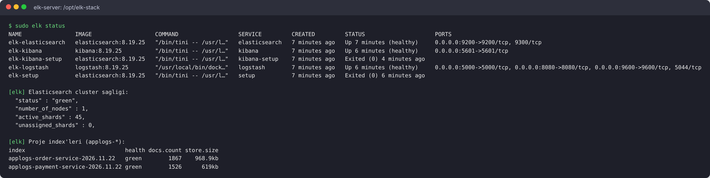
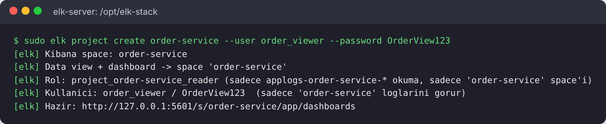
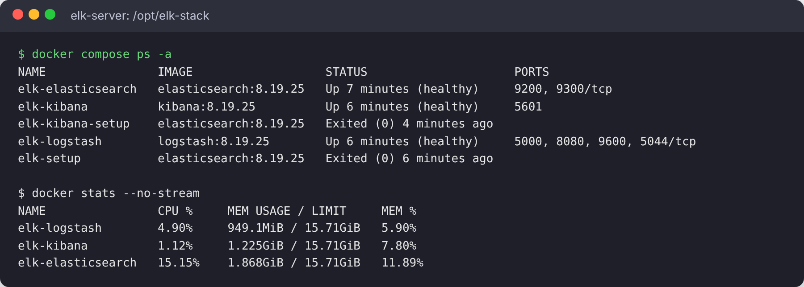

# elk-stack — ELK with Docker

🇬🇧 English | [🇹🇷 Türkçe](README.md)

The environment that is copied to the offline server (`install.sh` installs it under `/opt/elk-stack`).
It runs Elasticsearch + Logstash + Kibana with Docker Compose and performs every setup step automatically.

## What is ELK?

**ELK** stands for three open-source components that together form a central logging platform:

| Component | Job | Analogy | Details |
|---|---|---|---|
| **E**lasticsearch | Stores, indexes and searches logs | Database + search engine | [elasticsearch/README.en.md](elasticsearch/README.en.md) |
| **L**ogstash | Receives logs, normalizes them, writes to Elasticsearch | Entry gate / data pipeline | [logstash/README.en.md](logstash/README.en.md) |
| **K**ibana | Web UI: search, charts, dashboards, monitoring | The screen | [kibana/README.en.md](kibana/README.en.md) |
| **Docker** | Runs all of them as images/containers | The carrier | [docs/11-DOCKER.md](../docs/11-DOCKER.md) (TR) |

```
Java apps ──(elk-logger)──► Logstash :5000/:8080 ──► Elasticsearch :9200 ──► Kibana :5601 ──► Browser
```

## Layout

```
elk-stack/
├── docker-compose.yml          services, ports, volumes, health checks, startup order
├── .env.example                versions, ports, heap sizes, retention, passwords (→ .env)
├── bin/elk.sh                  management tool ('elk' command on the server)
├── elasticsearch/              elasticsearch.yml
├── logstash/                   config/logstash.yml, config/pipelines.yml, pipeline/applogs.conf
├── kibana/                     kibana.yml
└── setup/                      one-shot setup: users/roles/ILM/template + data view/dashboards
```

## Start

```bash
./bin/elk.sh init-secrets      # .env + random passwords (install.sh does this for you)
./bin/elk.sh up                # start and wait until every service is healthy
```


## `elk` commands

| Command | Description |
|---|---|
| `elk up` | Start, wait until healthy, print connection info |
| `elk status` | Container state, cluster health, per-project indices |
| `elk stop` / `elk start` / `elk restart [service]` | Stop / start / restart |
| `elk down` | Remove containers (data is kept) |
| `elk logs [service]` | Container logs |
| `elk test-log [project]` | Send a test event without Java |
| `elk project create <p> [--user u --password s] [--editor]` | Kibana Space + role (+ user) dedicated to one project |
| `elk project list` / `elk project delete-data <p>` | List projects / delete one project's logs |
| `elk snapshot create\|list\|restore` | Backups |
| `elk destroy` | Remove containers **and all data** |





## Docker view



Startup order: `elasticsearch (healthy)` → `setup (exit 0)` → `logstash` + `kibana (healthy)` → `kibana-setup (exit 0)`.
`setup` and `kibana-setup` do their job and exit; seeing them as `Exited (0)` is expected.

## Result: Kibana


Installation: [docs/02-KURULUM-RHEL.md](../docs/02-KURULUM-RHEL.md) (TR) · Operations: [docs/09-OPERASYON-VE-SORUN-GIDERME.md](../docs/09-OPERASYON-VE-SORUN-GIDERME.md) (TR)
