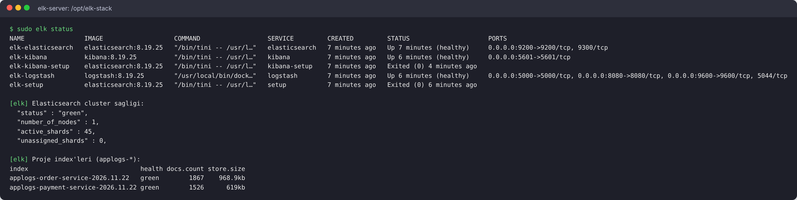
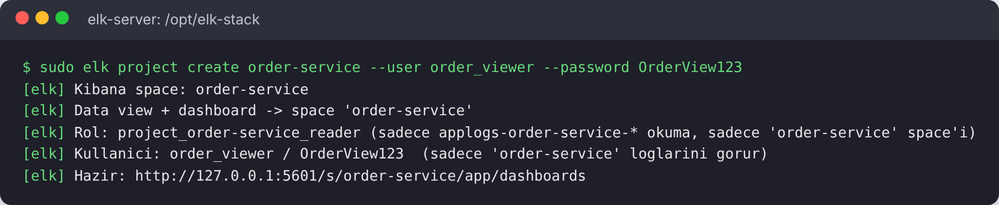
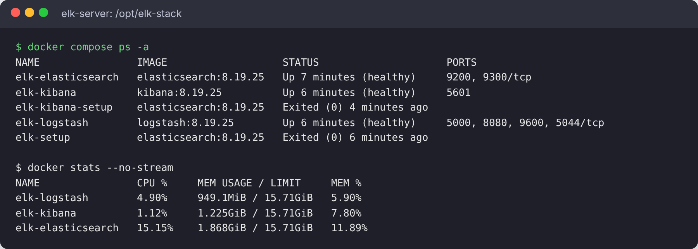
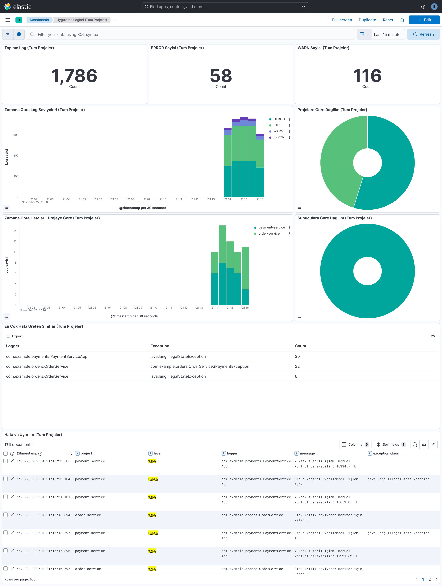

# elk-stack — Docker ile ELK Ortamı

Offline sunucuya kopyalanan ortam (`install.sh` bunu `/opt/elk-stack` altına kurar).
Elasticsearch + Logstash + Kibana'yı Docker Compose ile, tüm kurulum adımları otomatik olacak şekilde çalıştırır.

## ELK nedir?

**ELK**, üç açık kaynak bileşenin baş harfleridir ve birlikte merkezi bir log platformu oluştururlar:

| Bileşen | Görevi | Benzetme | Detay |
|---|---|---|---|
| **E**lasticsearch | Logları saklar, indeksler, arar | Veritabanı + arama motoru | [elasticsearch/README.md](elasticsearch/README.md) |
| **L**ogstash | Logları alır, düzenler, Elasticsearch'e yazar | Giriş kapısı / veri boru hattı | [logstash/README.md](logstash/README.md) |
| **K**ibana | Web arayüzü: arama, grafik, dashboard, izleme | Ekran | [kibana/README.md](kibana/README.md) |
| **Docker** | Hepsini imaj/container olarak çalıştırır | Taşıyıcı | [docs/11-DOCKER.md](../docs/11-DOCKER.md) |

```
Java uygulamaları ──(elk-logger)──► Logstash :5000/:8080 ──► Elasticsearch :9200 ──► Kibana :5601 ──► Tarayıcı
```

## Dizin yapısı

```
elk-stack/
├── docker-compose.yml          servisler, portlar, volume'lar, healthcheck'ler, başlangıç sırası
├── .env.example                sürüm, portlar, heap, saklama süresi, şifreler (→ .env)
├── bin/elk.sh                  yönetim aracı (sunucuda 'elk' komutu)
├── elasticsearch/              elasticsearch.yml
├── logstash/                   config/logstash.yml, config/pipelines.yml, pipeline/applogs.conf
├── kibana/                     kibana.yml
└── setup/                      tek seferlik kurulum: kullanıcı/rol/ILM/template + data view/dashboard
```

## Başlatma

```bash
./bin/elk.sh init-secrets      # .env + rastgele şifreler (install.sh bunu yapar)
./bin/elk.sh up                # başlat ve tüm servisler hazır olana kadar bekle
```


## `elk` komutları

| Komut | Açıklama |
|---|---|
| `elk up` | Başlat, sağlıklı olana kadar bekle, bağlantı bilgilerini yaz |
| `elk status` | Container durumu, cluster sağlığı, proje index'leri |
| `elk stop` / `elk start` / `elk restart [servis]` | Durdur / başlat / yeniden başlat |
| `elk down` | Container'ları sil (veri korunur) |
| `elk logs [servis]` | Container logları |
| `elk test-log [proje]` | Java olmadan test olayı gönder |
| `elk project create <p> [--user u --password s] [--editor]` | Projeye özel Kibana Space + rol (+ kullanıcı) |
| `elk project list` / `elk project delete-data <p>` | Projeleri listele / bir projenin loglarını sil |
| `elk snapshot create\|list\|restore` | Yedekleme |
| `elk destroy` | Container + tüm veri silinir |





## Docker görünümü



Başlangıç sırası: `elasticsearch (healthy)` → `setup (exit 0)` → `logstash` + `kibana (healthy)` → `kibana-setup (exit 0)`.
`setup` ve `kibana-setup` işini yapıp çıkar; `Exited (0)` görünmeleri normaldir.

## Sonuç: Kibana



Kurulum: [docs/02-KURULUM-RHEL.md](../docs/02-KURULUM-RHEL.md) · Operasyon: [docs/09-OPERASYON-VE-SORUN-GIDERME.md](../docs/09-OPERASYON-VE-SORUN-GIDERME.md)
