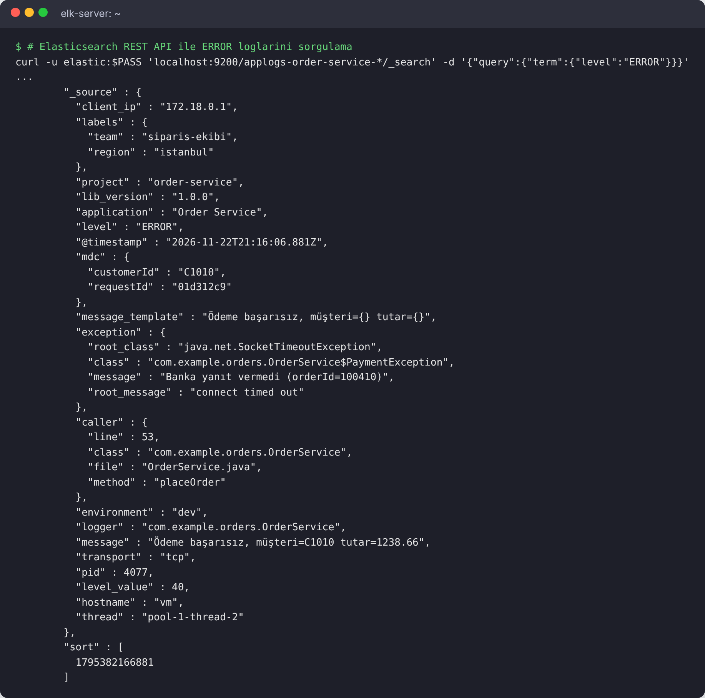
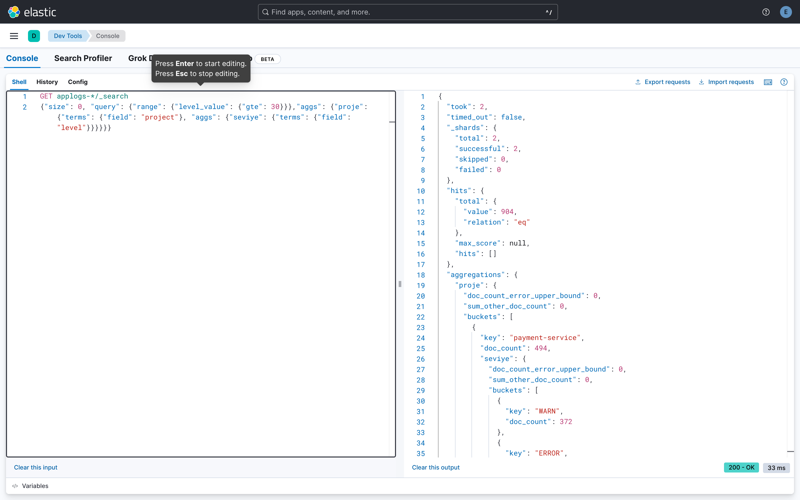
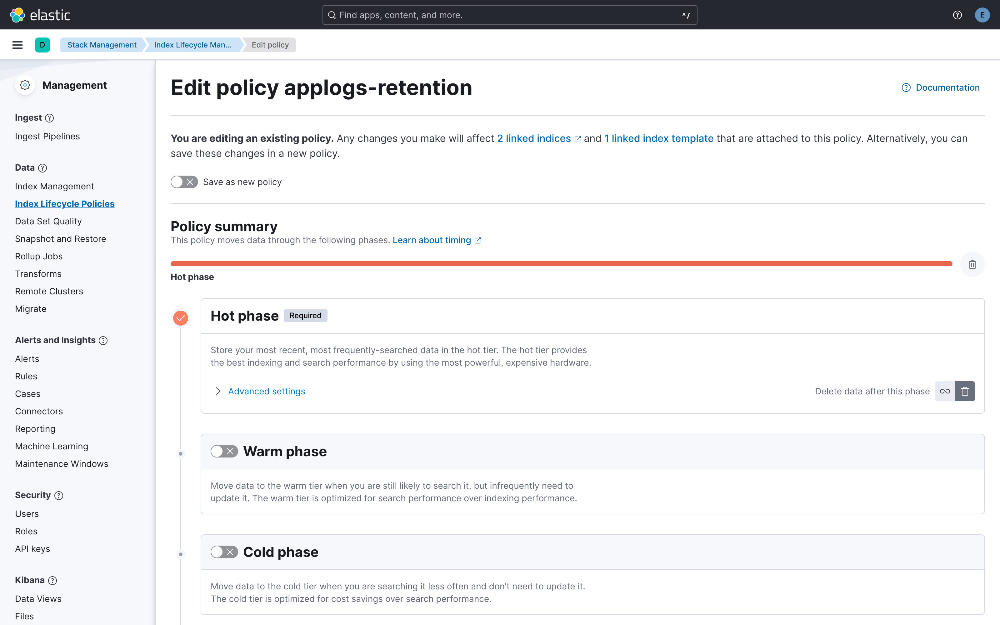

# Elasticsearch

🇬🇧 English | [🇹🇷 Türkçe](README.md)

## What is it?

**Elasticsearch (ES)** is a distributed search and analytics engine that stores JSON documents, indexes every field
automatically and performs **search, filtering and aggregations** over millions of records in milliseconds.
In this project it is where application logs are **stored and queried**.

| Concept | Meaning | In this project |
|---|---|---|
| **Document** | A single JSON record | One log event |
| **Index** | A collection of similar documents (like a database table) | `applogs-<project>-YYYY.MM.dd` — one daily index per project |
| **Mapping** | Field types (keyword, text, date, long...) | `setup/es/index-template.json` |
| **Index template** | Settings + mapping applied automatically to new indices | `applogs` (pattern `applogs-*`) |
| **keyword / text** | `keyword`: exact match and aggregation (e.g. `level`). `text`: full-text search (e.g. `message`) | |
| **Shard / replica** | Parts / copies of an index | 1 shard, 0 replicas (single server) |
| **ILM** | Index Lifecycle Management: manage/delete indices by age | `applogs-retention` → deleted after `LOG_RETENTION_DAYS` days |
| **Query DSL** | JSON-based query language | `GET applogs-*/_search {...}` |
| **ES\|QL** | SQL-like piped query language | `FROM applogs-* \| WHERE level == "ERROR"` |
| **Snapshot** | Backup of indices | `elk snapshot create` |

## File in this directory

[`elasticsearch.yml`](elasticsearch.yml) — single node, security enabled (username/password), HTTP TLS disabled,
Stack Monitoring collection on, GeoIP download disabled for offline use, snapshot directory, disk watermarks.
It is mounted read-only into the container; after changing it run `sudo elk restart elasticsearch`.

Heap size: `.env` → `ES_HEAP` (no more than half of the RAM).

## Usage

REST API at `http://<server>:9200` (user `elastic`, password in `/opt/elk-stack/.env`):

```bash
P=$(sudo grep ^ELASTIC_PASSWORD /opt/elk-stack/.env | cut -d= -f2)
curl -u elastic:$P 'localhost:9200/_cluster/health?pretty'                 # health
curl -u elastic:$P 'localhost:9200/_cat/indices/applogs-*?v&s=index'        # project indices
curl -u elastic:$P 'localhost:9200/applogs-order-service-*/_search?pretty' \
  -H 'Content-Type: application/json' \
  -d '{"query":{"bool":{"filter":[{"term":{"level":"ERROR"}},{"range":{"@timestamp":{"gte":"now-1h"}}}]}}}'
```



The same queries are easier in Kibana → **Dev Tools** (with auto-completion):



Indices and the retention policy are visible in Kibana → **Stack Management**:




More query examples, the full field list and ILM: [docs/03-ELASTICSEARCH.md](../../docs/03-ELASTICSEARCH.md) (TR).
