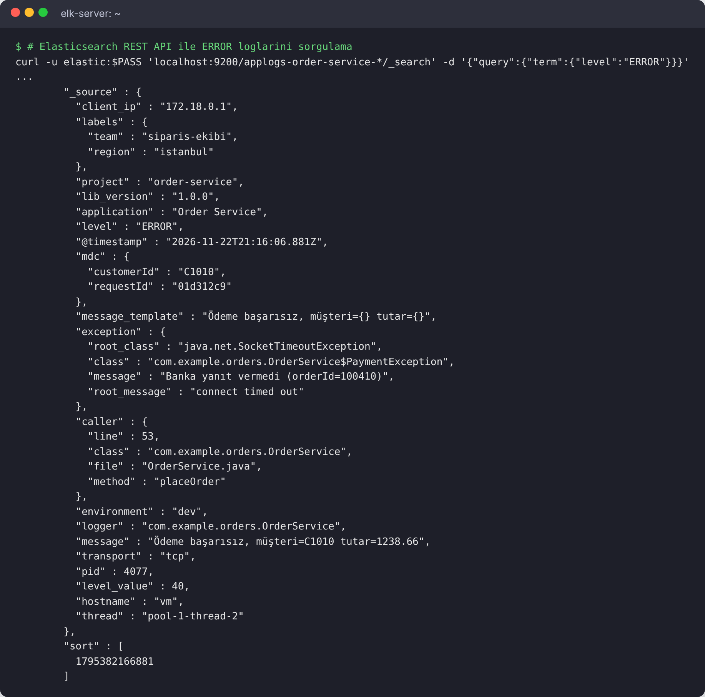
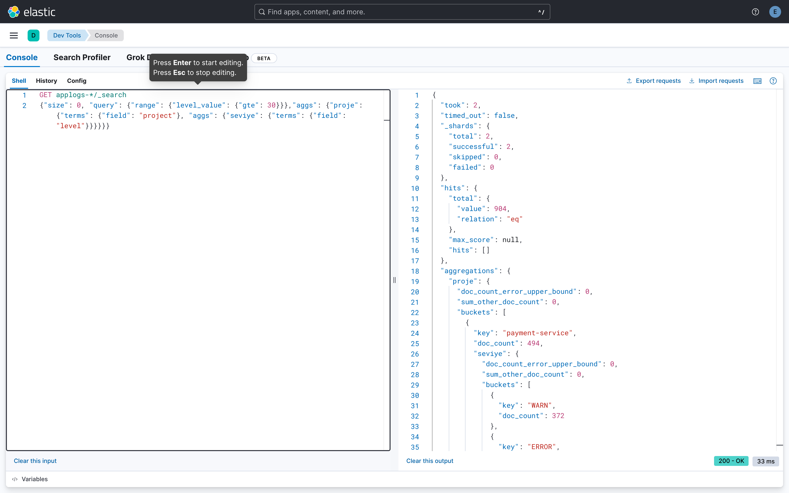
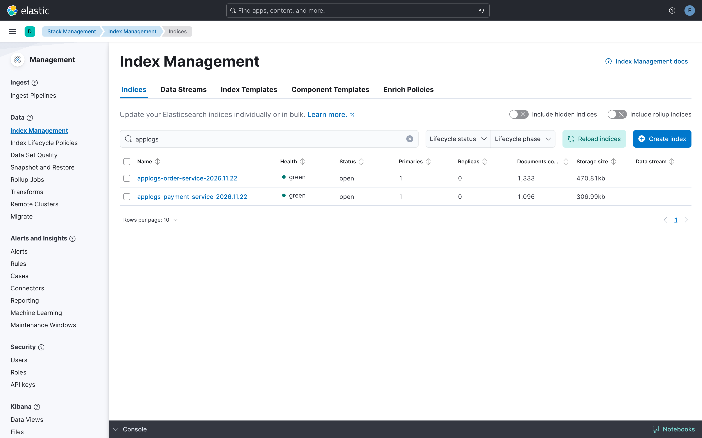
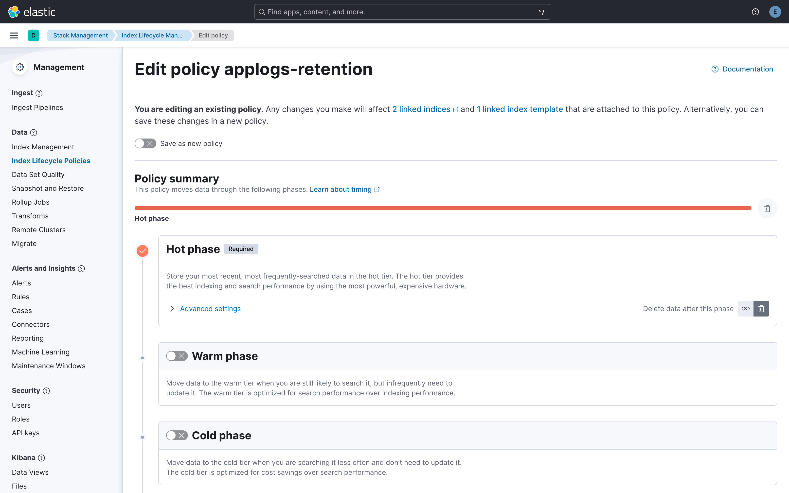

# Elasticsearch

[🇬🇧 English](README.en.md) | 🇹🇷 Türkçe

## Nedir?

**Elasticsearch (ES)**, JSON dokümanları saklayan, her alanı otomatik indeksleyen ve milyonlarca kayıt üzerinde
milisaniyeler içinde **arama, filtreleme ve istatistik (aggregation)** yapabilen dağıtık bir arama/analiz motorudur.
Bu projede uygulama loglarının **kalıcı olarak saklandığı ve sorgulandığı** yerdir.

| Kavram | Açıklama | Bu projede |
|---|---|---|
| **Doküman** | Tek bir JSON kaydı | Bir log olayı |
| **Index** | Aynı yapıdaki dokümanların koleksiyonu (veritabanı tablosuna benzer) | `applogs-<proje>-YYYY.MM.dd` — her proje için günlük index |
| **Mapping** | Alanların tipleri (keyword, text, date, long...) | `setup/es/index-template.json` |
| **Index template** | Yeni açılan index'lere otomatik uygulanan ayar + mapping | `applogs` (pattern `applogs-*`) |
| **keyword / text** | `keyword`: birebir eşleşme, gruplama (ör. `level`). `text`: kelime bazlı tam metin arama (ör. `message`) | |
| **Shard / replica** | Index'in parçaları / kopyaları | 1 shard, 0 replica (tek sunucu) |
| **ILM** | Index Lifecycle Management: index'leri yaşına göre yönetme/silme | `applogs-retention` → `LOG_RETENTION_DAYS` gün sonra sil |
| **Query DSL** | JSON tabanlı sorgu dili | `GET applogs-*/_search {...}` |
| **ES\|QL** | SQL benzeri boru (pipe) sorgu dili | `FROM applogs-* \| WHERE level == "ERROR"` |
| **Snapshot** | Index'lerin yedeği | `elk snapshot create` |

## Bu dizindeki dosya

[`elasticsearch.yml`](elasticsearch.yml) — tek node, güvenlik açık (kullanıcı/şifre), HTTP TLS kapalı,
Stack Monitoring veri toplama açık, offline için GeoIP indirme kapalı, snapshot dizini, disk eşikleri.
Container'a salt-okunur bağlanır; değiştirince `sudo elk restart elasticsearch`.

Heap boyutu `.env` → `ES_HEAP` (RAM'in yarısını geçmeyin).

## Kullanım

REST API `http://<sunucu>:9200` (kullanıcı `elastic`, şifre `/opt/elk-stack/.env`):

```bash
P=$(sudo grep ^ELASTIC_PASSWORD /opt/elk-stack/.env | cut -d= -f2)
curl -u elastic:$P 'localhost:9200/_cluster/health?pretty'                 # sağlık
curl -u elastic:$P 'localhost:9200/_cat/indices/applogs-*?v&s=index'        # proje index'leri
curl -u elastic:$P 'localhost:9200/applogs-order-service-*/_search?pretty' \
  -H 'Content-Type: application/json' \
  -d '{"query":{"bool":{"filter":[{"term":{"level":"ERROR"}},{"range":{"@timestamp":{"gte":"now-1h"}}}]}}}'
```



Kibana → **Dev Tools** konsolundan aynı sorgular daha rahat yazılır (otomatik tamamlama ile):



Index'leri ve saklama politikasını Kibana → **Stack Management** üzerinden görebilirsiniz:





Detaylı sorgu örnekleri, alan listesi ve ILM: [docs/03-ELASTICSEARCH.md](../../docs/03-ELASTICSEARCH.md).
