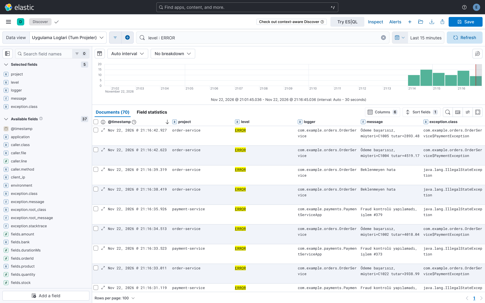
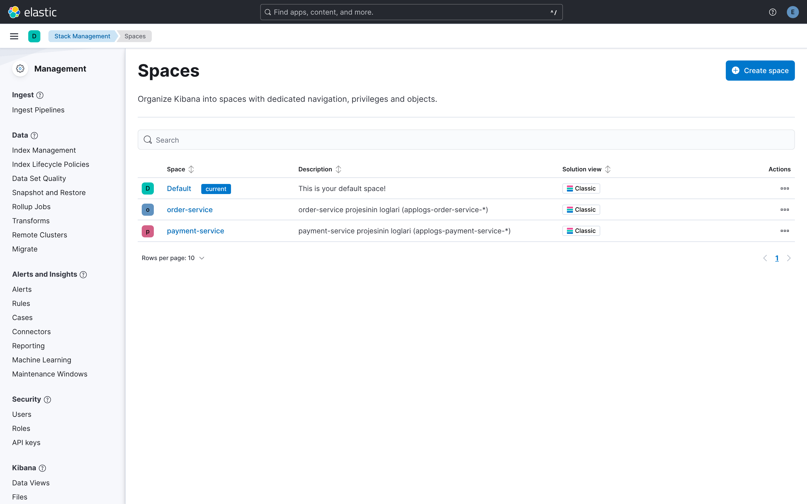
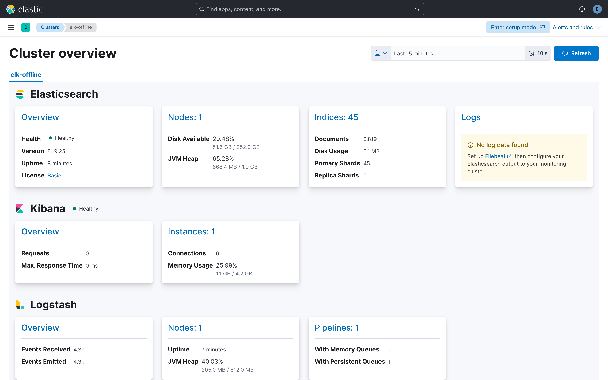
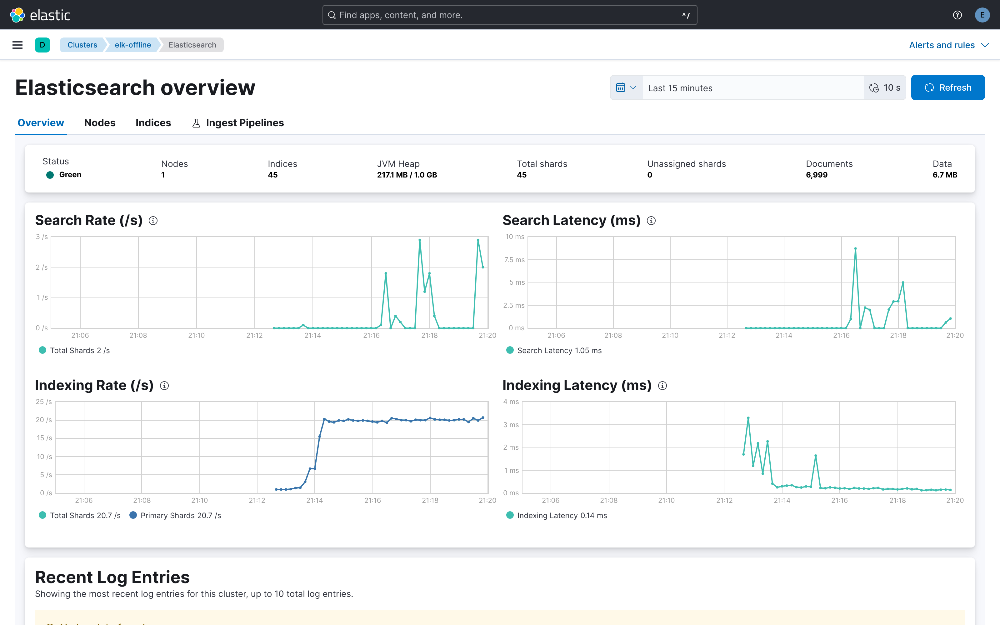

# Kibana

🇬🇧 English | [🇹🇷 Türkçe](README.md)

## What is it?

**Kibana** is the web UI used to **search, visualize and monitor** the data in Elasticsearch from a browser.
In this project it is where you read and filter logs, watch them on dashboards and track the health of ELK itself.

URL: `http://<server>:5601` — user `elastic`, password in `/opt/elk-stack/.env` → `ELASTIC_PASSWORD`.

| Concept | Meaning | In this project |
|---|---|---|
| **Data view** | Which indices to look at (formerly "index pattern") | `applogs-*` (all projects), `applogs-<project>-*` |
| **Discover** | Log search/filter screen | KQL such as `level : ERROR` |
| **KQL** | Kibana Query Language: `field : value and/or/not` | `fields.amount > 1000 and project : order-service` |
| **Visualization / Lens** | Charts, tables, metrics | Level distribution, error charts |
| **Dashboard** | Several visualizations on one screen | "Uygulama Loglari (Tum Projeler)" (all projects) + one per project |
| **Space** | Separate workspace inside Kibana | One Space per project (`elk project create`) |
| **Role / User** | Authorization | `project_<project>_reader` role: only its own project |
| **Stack Monitoring** | Metrics of ES/Logstash/Kibana themselves | Enabled |
| **Dev Tools** | Console for direct ES queries | |

## File in this directory

[`kibana.yml`](kibana.yml) — ES connection (`kibana_system`), encryption keys, Stack Monitoring and offline settings
(telemetry, news feed and the maps service disabled). After changing it run `sudo elk restart kibana`.

The data view, saved searches, visualizations and dashboards are loaded automatically from [`../setup/kibana/`](../setup/kibana).

## Screens

**Ready-made dashboard — all projects:**

**Discover — filtering with KQL** (`level : ERROR`):

**Discover — filtering by a structured field and document details** (`project : order-service and fields.stock < 10`):

**Project spaces** — created with `elk project create`:

**What a project user sees** (only their own space and their own logs):

**Stack Monitoring:**

KQL examples, building your own dashboards, alerting and backups: [docs/05-KIBANA.md](../../docs/05-KIBANA.md) (TR).
