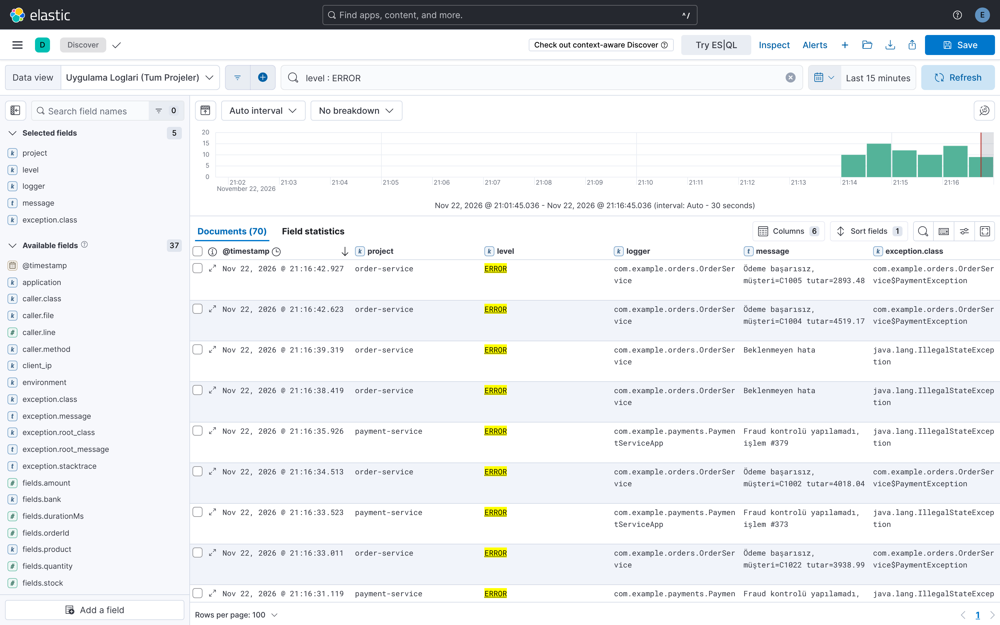
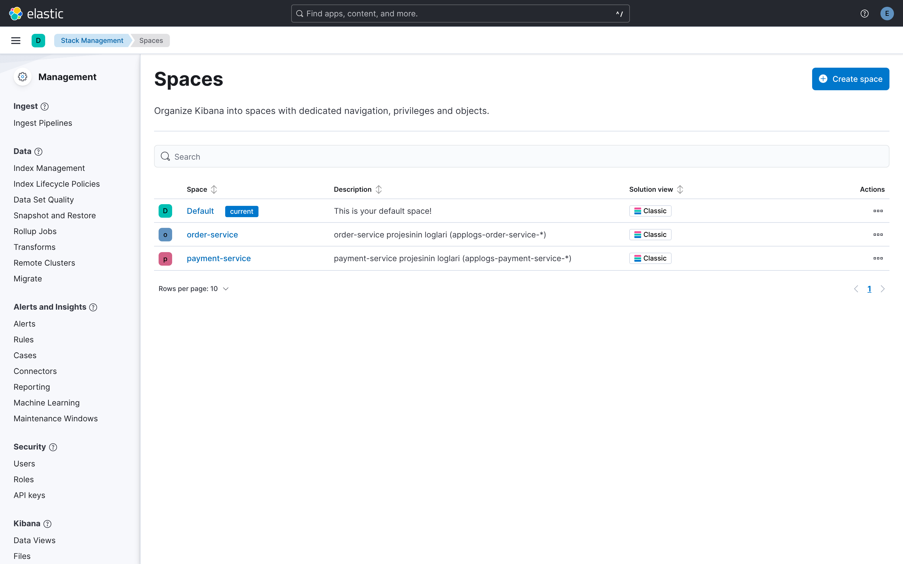
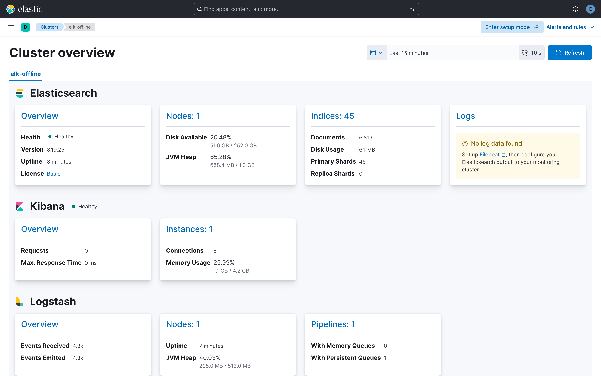
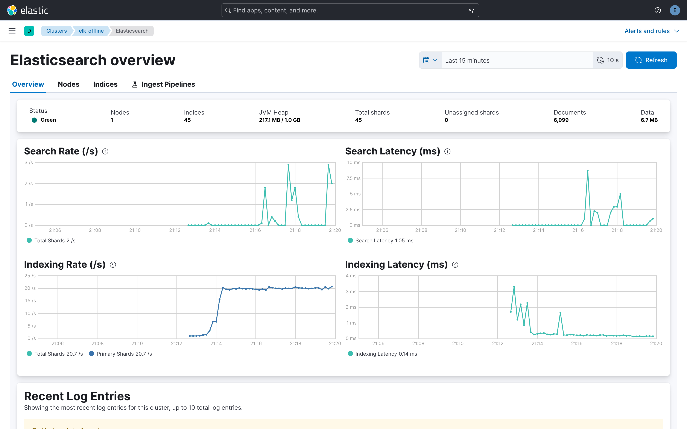

# Kibana

[🇬🇧 English](README.en.md) | 🇹🇷 Türkçe

## Nedir?

**Kibana**, Elasticsearch'teki veriyi tarayıcıdan **aramak, görselleştirmek ve izlemek** için kullanılan web arayüzüdür.
Bu projede logları okumanın, filtrelemenin, dashboard'larla izlemenin ve ELK'nın kendi sağlığını takip etmenin yeridir.

Adres: `http://<sunucu>:5601` — kullanıcı `elastic`, şifre `/opt/elk-stack/.env` → `ELASTIC_PASSWORD`.

| Kavram | Açıklama | Bu projede |
|---|---|---|
| **Data view** | Hangi index'lere bakılacağı (eski adı index pattern) | `applogs-*` (tüm projeler), `applogs-<proje>-*` |
| **Discover** | Log arama/filtreleme ekranı | KQL ile `level : ERROR` vb. |
| **KQL** | Kibana Query Language: `alan : değer and/or/not` | `fields.amount > 1000 and project : order-service` |
| **Visualization / Lens** | Grafik, tablo, metrik | Seviye dağılımı, hata grafikleri |
| **Dashboard** | Görselleştirmelerin bir arada olduğu ekran | "Uygulama Logları (Tüm Projeler)" + proje başına |
| **Space** | Kibana içinde ayrı çalışma alanı | Her proje için ayrı space (`elk project create`) |
| **Role / User** | Yetkilendirme | `project_<proje>_reader` rolü: sadece kendi projesi |
| **Stack Monitoring** | ES/Logstash/Kibana'nın kendi metrikleri | Açık |
| **Dev Tools** | ES'ye doğrudan sorgu konsolu | |

## Bu dizindeki dosya

[`kibana.yml`](kibana.yml) — ES bağlantısı (`kibana_system`), şifreleme anahtarları, Stack Monitoring ve
offline ayarlar (telemetri, haber akışı, harita servisi kapalı). Değiştirince `sudo elk restart kibana`.

Hazır data view, kayıtlı aramalar, görselleştirmeler ve dashboard'lar
[`../setup/kibana/`](../setup/kibana) altından otomatik yüklenir.

## Ekranlar

**Hazır dashboard — tüm projeler:**

**Discover — KQL ile filtreleme** (`level : ERROR`):

**Discover — yapısal alanla filtreleme ve doküman detayı** (`project : order-service and fields.stock < 10`):

**Proje alanları (Spaces)** — `elk project create` ile oluşturulur:

**Proje kullanıcısının gördüğü** (sadece kendi space'i ve kendi logları):

**Stack Monitoring:**

KQL örnekleri, kendi dashboard'unuzu yapmak, alarmlar ve yedekleme: [docs/05-KIBANA.md](../../docs/05-KIBANA.md).
