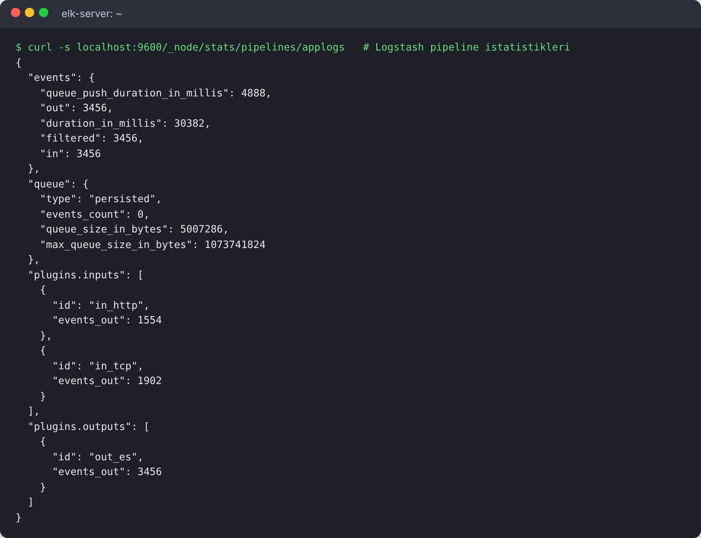
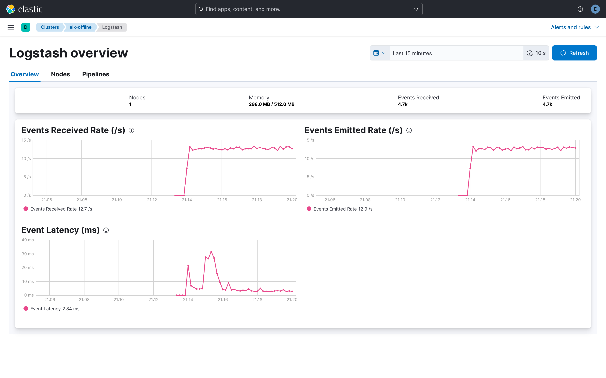

# Logstash

🇬🇧 English | [🇹🇷 Türkçe](README.md)

## What is it?

**Logstash** is a data processing pipeline that receives data from different sources (**input**), transforms/enriches it
(**filter**) and writes it to one or more destinations (**output**). In this project it is the **entry gate** between the
applications and Elasticsearch: applications only know Logstash's ports and never the ES password.

```
  Java application ──TCP 5000 / HTTP 8080──► [ input ] ─► [ filter ] ─► [ output ] ──► Elasticsearch
                                              tcp/http     project       applogs-<project>-YYYY.MM.dd
                                              json         sanitize,
                                                           client_ip
```

| Concept | Meaning | In this project |
|---|---|---|
| **Pipeline** | input → filter → output definition | `applogs` ([`pipeline/applogs.conf`](pipeline/applogs.conf)) |
| **Input** | Where data comes from | `tcp` (5000, json_lines), `http` (8080, JSON array) |
| **Codec** | How incoming bytes become events | `json_lines`, `json` |
| **Filter** | Steps that modify an event (`mutate`, `grok`, `date`, `drop`...) | project name sanitizing, `client_ip`, `transport` |
| **Output** | Where data is written | `elasticsearch` (user `logstash_writer`) |
| **Persisted queue** | On-disk queue; no data loss on restart | `queue.type: persisted` (1 GB) |
| **DLQ** | Dead letter queue for events rejected by ES | enabled |
| **Monitoring API** | Statistics on `:9600` | `_node/stats/pipelines/applogs` |

## Files in this directory

| File | Contents |
|---|---|
| [`config/logstash.yml`](config/logstash.yml) | General settings: persisted queue, DLQ, Stack Monitoring, ECS compatibility off |
| [`config/pipelines.yml`](config/pipelines.yml) | Pipeline list, workers and batch size |
| [`pipeline/applogs.conf`](pipeline/applogs.conf) | Inputs, filters, ES output |

After a change: `sudo elk restart logstash` and check `sudo elk logs logstash`.

## Usage

```bash
curl -s localhost:9600/_node/stats/pipelines/applogs?pretty   # events in/out, queue
sudo elk test-log demo                                         # send a test event without Java
echo '{"project":"demo","level":"INFO","message":"hello"}' > /dev/tcp/127.0.0.1/5000   # manual event
curl -XPOST localhost:8080 -H 'Content-Type: application/json' -d '[{"project":"demo","message":"http"}]'
```



Kibana → **Stack Monitoring → Logstash** shows event rate, latency and JVM usage:



Adding filters (masking, drop), basic auth, new pipelines and tuning: [docs/04-LOGSTASH.md](../../docs/04-LOGSTASH.md) (TR).
