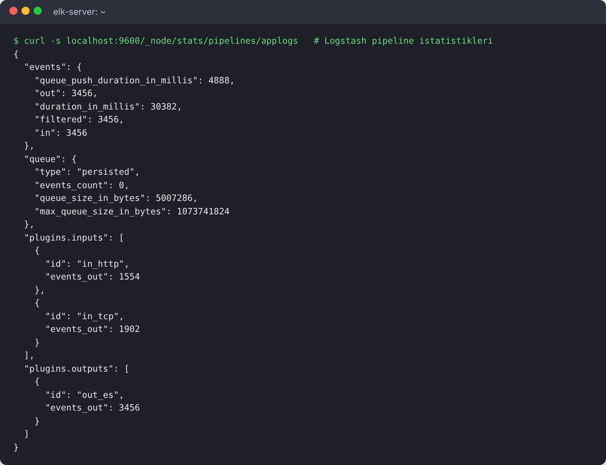
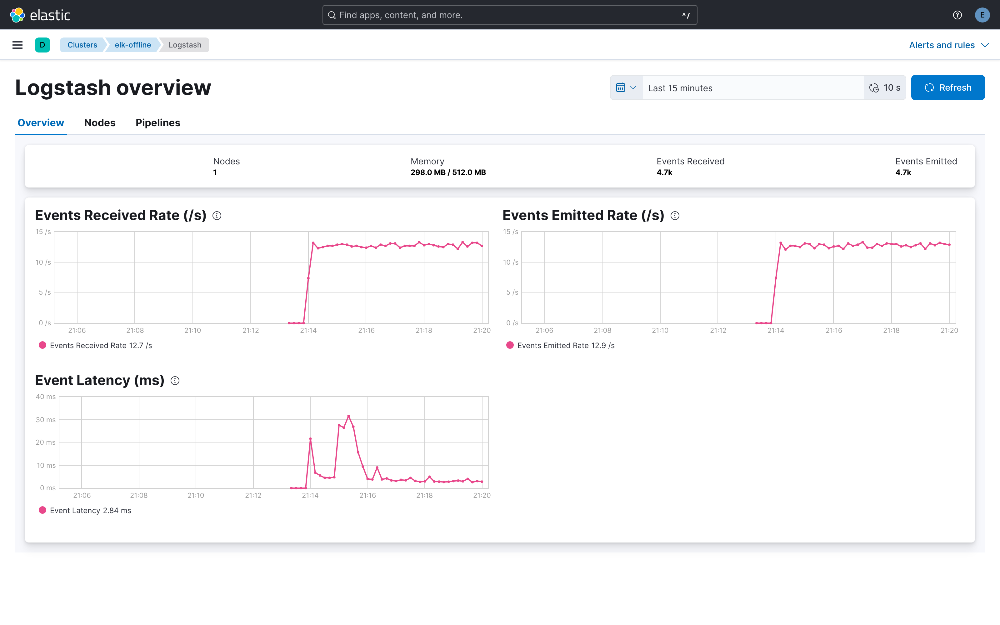

# Logstash

## Nedir?

**Logstash**, farklı kaynaklardan veri alan (**input**), bu veriyi dönüştüren/zenginleştiren (**filter**) ve
bir veya daha fazla hedefe yazan (**output**) bir veri işleme hattıdır (pipeline). Bu projede uygulamalar ile
Elasticsearch arasındaki **giriş kapısıdır**: uygulamalar sadece Logstash'in portlarını bilir, ES şifresini bilmez.

```
  Java uygulaması ──TCP 5000 / HTTP 8080──► [ input ] ─► [ filter ] ─► [ output ] ──► Elasticsearch
                                             tcp/http     project       applogs-<project>-YYYY.MM.dd
                                             json         sanitize,
                                                          client_ip
```

| Kavram | Açıklama | Bu projede |
|---|---|---|
| **Pipeline** | input → filter → output tanımı | `applogs` ([`pipeline/applogs.conf`](pipeline/applogs.conf)) |
| **Input** | Verinin geldiği yer | `tcp` (5000, json_lines), `http` (8080, JSON dizi) |
| **Codec** | Gelen baytları olaya çeviren biçim | `json_lines`, `json` |
| **Filter** | Olayı değiştiren adımlar (`mutate`, `grok`, `date`, `drop`...) | proje adı temizleme, `client_ip`, `transport` |
| **Output** | Verinin yazıldığı yer | `elasticsearch` (kullanıcı `logstash_writer`) |
| **Persisted queue** | Diskte tutulan kuyruk; yeniden başlamada veri kaybı olmaz | `queue.type: persisted` (1 GB) |
| **DLQ** | ES'nin reddettiği olayların saklandığı "ölü mektup" kuyruğu | açık |
| **Monitoring API** | `:9600` üzerinden istatistik | `_node/stats/pipelines/applogs` |

## Bu dizindeki dosyalar

| Dosya | İçerik |
|---|---|
| [`config/logstash.yml`](config/logstash.yml) | Genel ayarlar: kalıcı kuyruk, DLQ, Stack Monitoring, ECS uyumluluğu kapalı |
| [`config/pipelines.yml`](config/pipelines.yml) | Pipeline listesi, worker ve batch ayarları |
| [`pipeline/applogs.conf`](pipeline/applogs.conf) | Input'lar, filtreler, ES çıktısı |

Değişiklikten sonra: `sudo elk restart logstash` ve `sudo elk logs logstash`.

## Kullanım

```bash
curl -s localhost:9600/_node/stats/pipelines/applogs?pretty   # gelen/giden olay sayıları, kuyruk
sudo elk test-log demo                                         # Java olmadan test olayı gönder
echo '{"project":"demo","level":"INFO","message":"merhaba"}' > /dev/tcp/127.0.0.1/5000   # elle olay
curl -XPOST localhost:8080 -H 'Content-Type: application/json' -d '[{"project":"demo","message":"http"}]'
```



Kibana → **Stack Monitoring → Logstash** ekranında olay hızı, gecikme ve JVM kullanımı izlenir:



Filtre ekleme (maskeleme, drop), basic auth, yeni pipeline ve performans ayarları:
[docs/04-LOGSTASH.md](../../docs/04-LOGSTASH.md).
