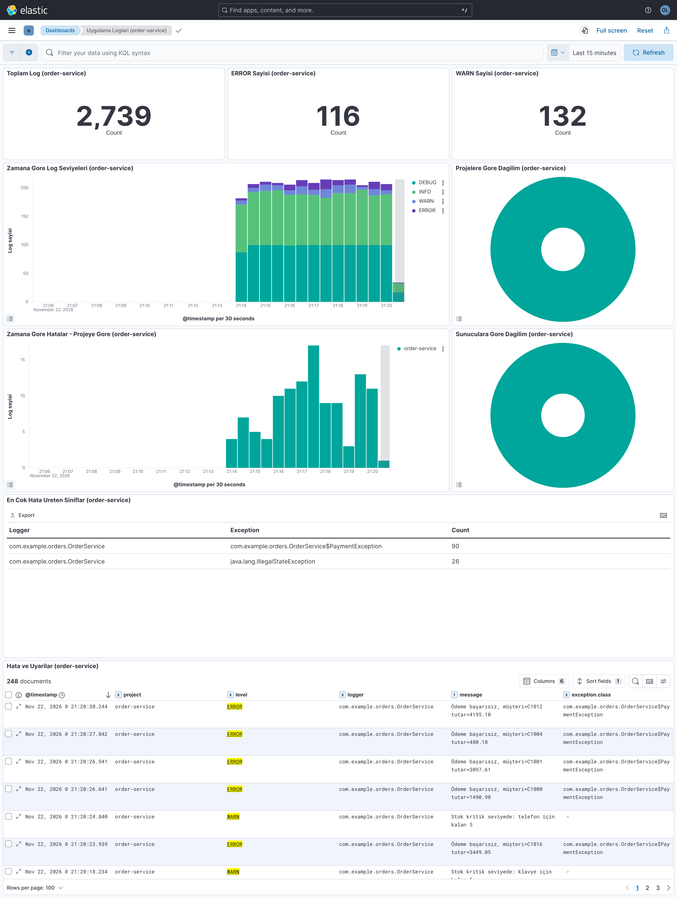

# Sample Projects

🇬🇧 English | [🇹🇷 Türkçe](README.md)

| Project | Build | API | Transport | Logging space |
|---|---|---|---|---|
| [`order-service-sample`](order-service-sample) (A) | Maven | elk-logger native | TCP 5000 | `applogs-order-service-*` |
| [`payment-service-slf4j-sample`](payment-service-slf4j-sample) (B) | Maven | SLF4J + elk-logger-slf4j | HTTP 8080 | `applogs-payment-service-*` |
| [`gradle-sample`](gradle-sample/README.en.md) (C) | **Gradle** | elk-logger native | TCP 5000 | `applogs-inventory-service-*` |
| [`plain-java-sample`](plain-java-sample/README.en.md) (D) | **none** (classpath) | elk-logger native | TCP 5000 | `applogs-billing-batch-*` |

Project D uses no build tool at all (`javac` / `java -cp`, `java -jar`, an `application.classpath` argument file,
`CLASSPATH`, Eclipse `.classpath`).

## Run

```bash
./examples/run-sample.sh order 200 50       # 200 orders, 50 ms apart
./examples/run-sample.sh payment 100 50
./examples/run-sample.sh plain 50 50        # project D (plain Java)
(cd examples/gradle-sample && gradle --offline run)   # project C (Gradle)
./examples/run-sample.sh order 0 300        # until Ctrl+C
ELK_HOST=10.0.0.5 ./examples/run-sample.sh order   # ELK on another server
```


## Result

Each project writes to its own indices:


A user created with `elk project create order-service --user order_viewer ...` sees only their own project:



Details: [docs/08-ORNEK-PROJELER.md](../docs/08-ORNEK-PROJELER.md) (TR).
