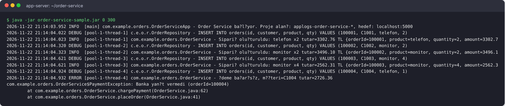

# elk-logger — Java 11 Logging Library

🇬🇧 English | [🇹🇷 Türkçe](README.md)

Log with an SLF4J-like API; events are shipped to the ELK environment in the background. **No dependencies at all**
(a single jar, Java 11+). Environment details (address, port, levels...) come only from `elk-logger.properties`.

## 1. Add it

Your project can use Maven, Gradle or no build tool at all — the jar just has to be on the classpath.

**Maven:**
```xml
<dependency>
  <groupId>io.github.elkboilerplate</groupId>
  <artifactId>elk-logger</artifactId>
  <version>1.0.0</version>
</dependency>
```
Offline machine without a repository manager: `libs/install-to-local-maven-repo.sh` installs the jars into `~/.m2`.

**Gradle:**
```groovy
dependencies { implementation files('libs/elk-logger-1.0.0.jar') }   // Kotlin DSL: implementation(files("libs/elk-logger-1.0.0.jar"))
```

**Plain Java (no Maven/Gradle):**
```bash
javac -cp "lib/*" -d build/classes $(find src -name '*.java')
java  -cp "build/classes:lib/*:config" com.acme.Main          # Windows: "build\classes;lib\*;config"
java  @application.classpath com.acme.Main                    # or read the classpath from a file
java  -jar app.jar                                            # MANIFEST: Class-Path: lib/elk-logger-1.0.0.jar config/
```

Jar: [`dist/elk-logger-1.0.0.jar`](../../dist) ·
Samples: [Gradle](../../examples/gradle-sample/README.en.md), [plain Java](../../examples/plain-java-sample/README.en.md)

## 2. Configure — `elk-logger.properties`

Maven/Gradle: `src/main/resources/`. Plain Java: a `config/` directory on the classpath, or `elk-logger.properties` /
`config/elk-logger.properties` in the working directory (found automatically), or `-Delk.config.file=...`.

```properties
elk.project.name=order-service     # logging space -> applogs-order-service-*
elk.logstash.host=10.0.0.5         # ELK server
elk.logstash.tcp.port=5000
elk.level=INFO
elk.level.com.acme.dao=DEBUG
```

Lookup order (later wins): classpath → working directory → `-Delk.config.file` / `ELK_CONFIG_FILE`
(`classpath:name.properties` also works) → `ELK_*` environment variables → `-Delk.*` system properties.
Every key with its default: [elk-logger.properties.example](elk-logger.properties.example).

## 3. Log

```java
private static final ElkLogger log = ElkLoggerFactory.getLogger(OrderService.class);

log.info("Order created: {}", orderId);
log.error("Payment failed, customer={}", customerId, exception);     // stack trace -> exception.*
log.atWarn().field("product", "laptop").field("stock", 2).tag("stock")
   .log("Low stock: {}", "laptop");                                  // fields.product, fields.stock

ElkMDC.put("requestId", requestId);                                  // mdc.requestId -> on every log of this thread
```

Console output (while developing):



The same events in Kibana, with filterable fields:


## Features

- `{}` placeholders, trailing exception argument, `isDebugEnabled()` — same rules as SLF4J
- Structured fields (`fields.*`), tags (`tags`), MDC (`mdc.*`), static labels (`labels.*`)
- Asynchronous delivery: logging never blocks and never throws into your application
- TCP (fast) or HTTP (acknowledged) transport, optional TLS
- If ELK is unreachable: retry with backoff + bounded queue + local fallback file
- Per-package levels, runtime level changes, statistics (`ElkLoggerFactory.getStats()`)
- For projects that already use SLF4J: [`elk-logger-slf4j`](../elk-logger-slf4j) provider (no code changes)

Full guide: [docs/06-JAVA-KUTUPHANE.md](../../docs/06-JAVA-KUTUPHANE.md) (TR) · all settings: [docs/07](../../docs/07-KONFIGURASYON-REFERANSI.md) (TR).
