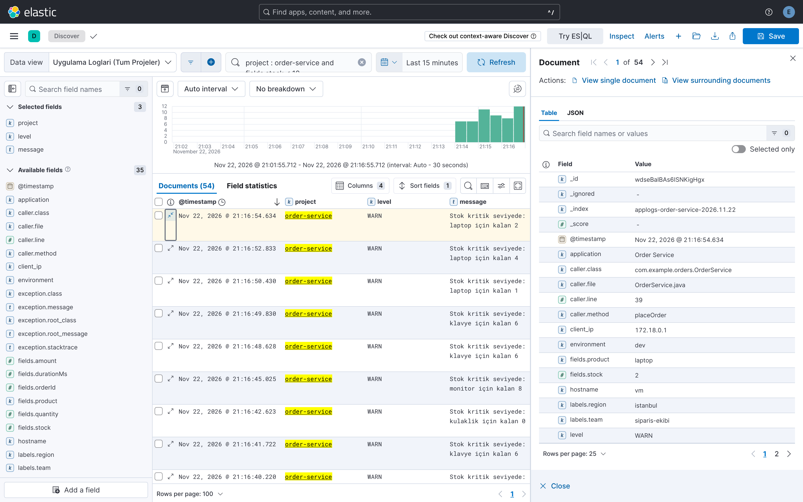

# elk-logger — Java 11 Loglama Kütüphanesi

SLF4J'ye benzer API ile loglayın; loglar arka planda ELK ortamına gider. **Hiçbir bağımlılığı yoktur**
(tek jar, Java 11+). Ortam bilgisi (adres, port, seviye...) sadece `elk-logger.properties` dosyasından okunur.

## 1. Ekle

```xml
<dependency>
  <groupId>io.github.elkboilerplate</groupId>
  <artifactId>elk-logger</artifactId>
  <version>1.0.0</version>
</dependency>
```
Jar: [`dist/elk-logger-1.0.0.jar`](../../dist) · Offline Maven kurulumu: `libs/install-to-local-maven-repo.sh`

## 2. Yapılandır — `src/main/resources/elk-logger.properties`

```properties
elk.project.name=order-service     # loglama alanı -> applogs-order-service-*
elk.logstash.host=10.0.0.5         # ELK sunucusu
elk.logstash.tcp.port=5000
elk.level=INFO
elk.level.com.acme.dao=DEBUG
```
Tüm ayarlar: [elk-logger.properties.example](elk-logger.properties.example) · [docs/07](../../docs/07-KONFIGURASYON-REFERANSI.md)

## 3. Logla

```java
private static final ElkLogger log = ElkLoggerFactory.getLogger(OrderService.class);

log.info("Sipariş oluşturuldu: {}", orderId);
log.error("Ödeme başarısız, müşteri={}", customerId, exception);     // stack trace -> exception.*
log.atWarn().field("product", "laptop").field("stock", 2).tag("stock")
   .log("Stok kritik: {}", "laptop");                                 // fields.product, fields.stock

ElkMDC.put("requestId", requestId);                                   // mdc.requestId -> tüm loglara
```

Konsol çıktısı (geliştirirken):


Aynı loglar Kibana'da filtrelenebilir alanlarla:



## Özellikler

- `{}` yer tutucu, son argüman exception, `isDebugEnabled()` — SLF4J ile aynı kurallar
- Yapısal alanlar (`fields.*`), etiketler (`tags`), MDC (`mdc.*`), sabit etiketler (`labels.*`)
- Asenkron gönderim: uygulama asla beklemez, asla exception almaz
- TCP (hızlı) veya HTTP (onaylı) transport, opsiyonel TLS
- ELK erişilemezse yeniden deneme + kuyruk + yerel fallback dosyası
- Paket bazlı seviye, çalışma zamanında seviye değiştirme, istatistikler (`ElkLoggerFactory.getStats()`)
- SLF4J kullanan projeler için: [`elk-logger-slf4j`](../elk-logger-slf4j)

Tam rehber: [docs/06-JAVA-KUTUPHANE.md](../../docs/06-JAVA-KUTUPHANE.md).
